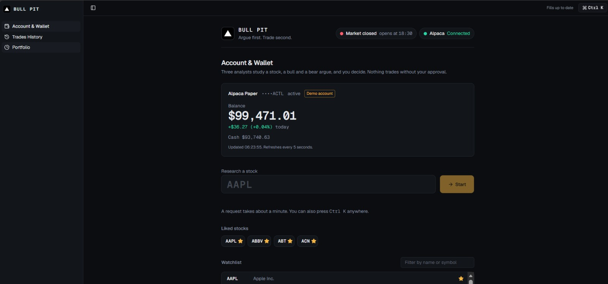
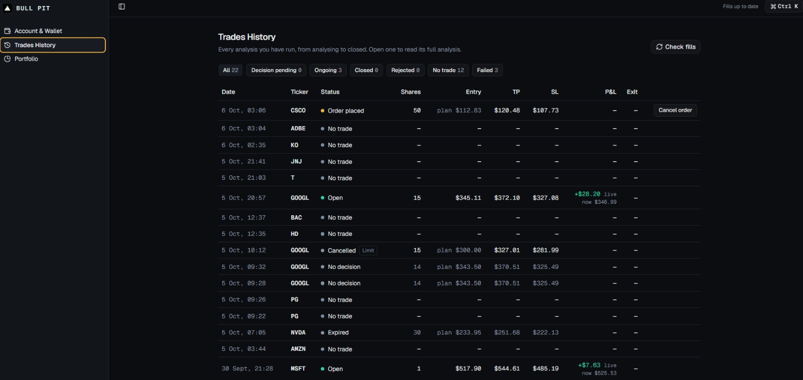
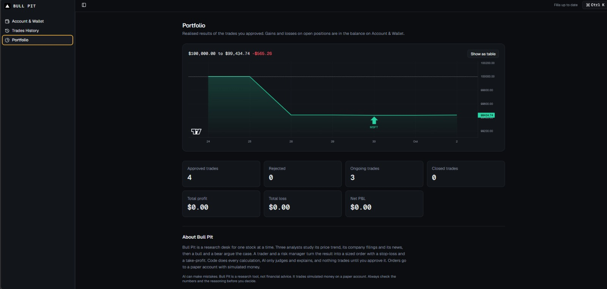
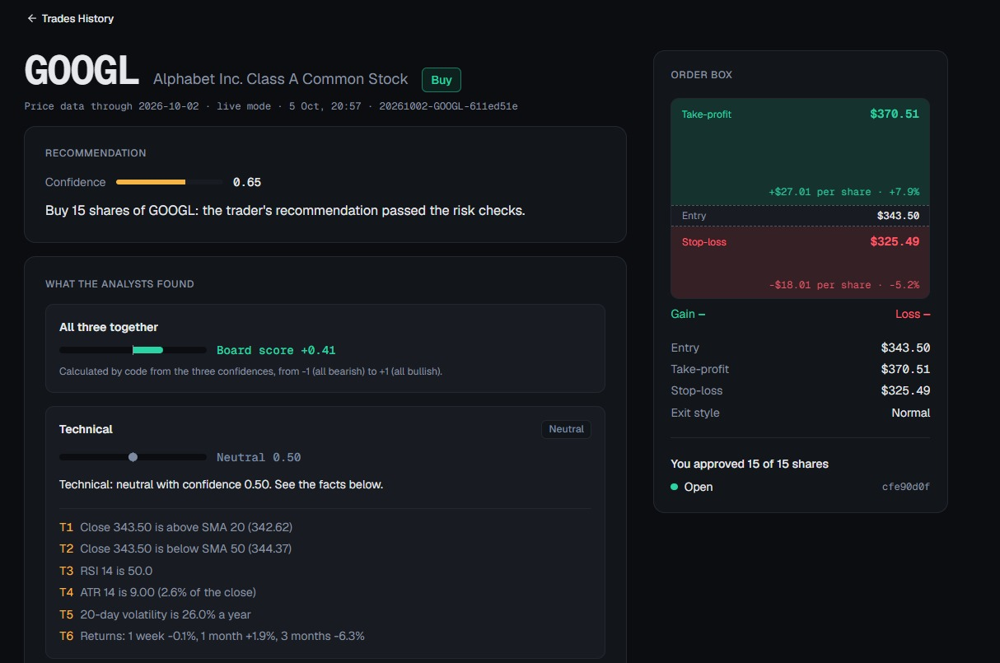
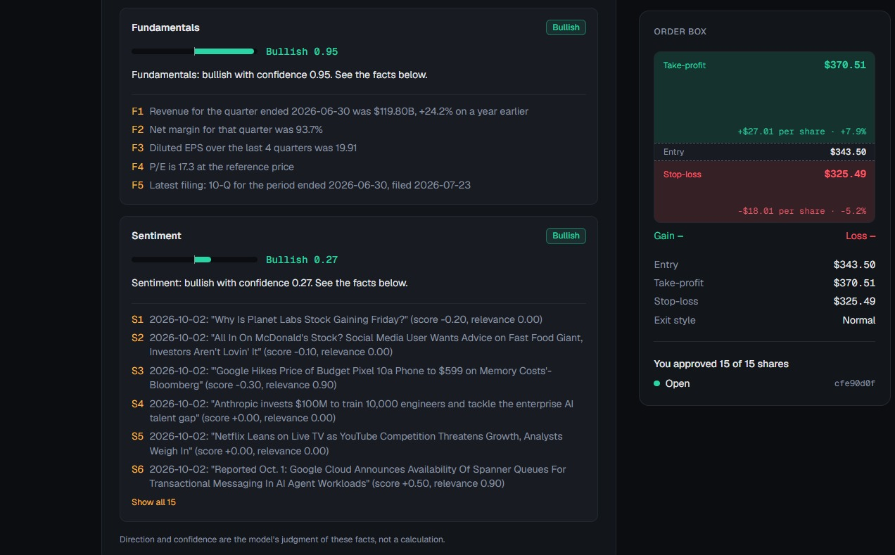
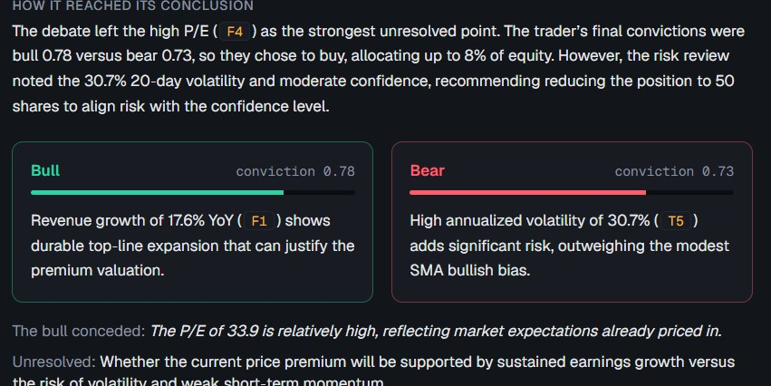
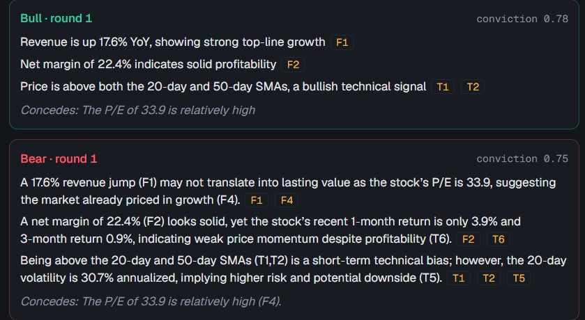
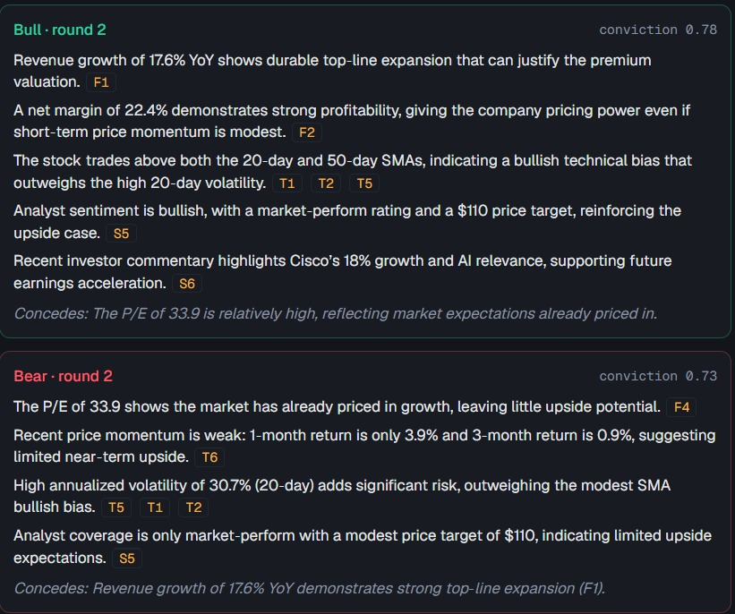
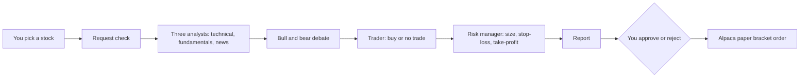

# Bull Pit

A multi-agent AI stock research and paper-trading system. You pick a stock;
three analyst agents (technical, fundamentals, news sentiment) study it; a
bull and a bear agent debate the evidence; a trader recommends buy or no
trade; a risk manager sizes and checks it; a report is produced; **you
approve every trade**.

> **Paper trading only. Not financial advice.** Every trade goes to an
> Alpaca **paper** account (fake money, real prices) or a simulated broker
> in backtests. The code refuses to start against anything but Alpaca's
> paper endpoint. Reports are a research tool, not investment advice. This is
> a personal portfolio project: all rights reserved.

Full design and build process: [`docs/architecture.md`](docs/architecture.md)
(what it does) and [`docs/dev-plan.md`](docs/dev-plan.md) (how it's built,
milestone by milestone). Status of each milestone: [`docs/progress.md`](docs/progress.md).

## Screenshots

**Account & Wallet**: the paper account's balance, the ticker box and the watchlist.



**Trades History**: one row per analysis, with live profit and loss on open trades.



**Portfolio**: the equity chart and the realised statistics.



**The report**: the recommendation, the board score, each analyst's facts and the order box.





**The debate**: how it reached its conclusion, then each round with its evidence IDs.







## How it works



- **Code does the math, AI does the judgment.** Indicators, ratios, share counts,
  exits, rules and every number in the report are plain, tested Python. The
  models only read the facts, argue, and explain; a number check rejects any
  figure a model invents.
- **You decide.** Nothing trades until you approve, and the share count can only
  go down unless you switch on advanced mode (cash is still a hard limit).
- **The past can't leak into a backtest.** A date guard filters every data request
  and every response, and backtests start after the models' training cutoff.
- **Every buy has its exits.** An approved buy is one bracket order (entry,
  stop-loss, take-profit) handled by the broker.

Details: [architecture §4 and §5](docs/architecture.md#4-system-overview).

## Quick start

Requires Python 3.12, [`uv`](https://docs.astral.sh/uv/), and (for the
dashboard) Node 22. You also need three free accounts:

- an [Alpaca](https://alpaca.markets) **paper** trading account (API key and secret),
- a [Groq](https://console.groq.com) API key (the free tier runs the pinned models),
- an email address for the SEC's User-Agent header (any email you own).

```bash
# 1. Install dependencies into a local virtual environment.
uv sync

# 2. Copy the environment template and fill in your own keys
#    (on Windows: copy .env.example .env).
cp .env.example .env
# then edit .env: ALPACA_API_KEY, ALPACA_SECRET_KEY, GROQ_API_KEY and
# SEC_CONTACT_EMAIL. Leave ALPACA_BASE_URL as it is. .env is git-ignored.

# 3. Check everything is configured and every external service is reachable.
uv run bullpit doctor

# 4. Create the journal database (a local SQLite file).
uv run alembic upgrade head

# 5. Run your first research request on a past date (about a minute, about
#    15K free Groq tokens when the analysts' signals lead to a debate).
uv run bullpit request AAPL --mode backtest --as-of 2024-07-12
# Live mode (today's data, no --as-of): uv run bullpit request AAPL
```

Step 4 is optional: `bullpit request` applies any pending migration itself.

`doctor` prints one line per check (config, the paper-only guard, Alpaca
trading and data, Groq, SEC EDGAR, yfinance) and exits non-zero if anything
needs fixing, without ever printing a secret.

`bullpit request` prints the account snapshot, each analyst's signal with
its evidence, the signals board's score and conflict, and the route
(`debate` or `no_trade`). When the route is `debate`, it goes on to print
each bull/bear turn (points with their evidence IDs, `[unsupported]` if a
citation doesn't check out, concessions, conviction), each trader attempt
(the recommendation, the sized order or the block reason, the risk
manager's decision and reason), and a final line:

```text
OUTCOME: BUY 30 JPM @ ref 225.37, stop 216.94, take-profit 238.01, max loss 252.90, gain 379.20 (set by target)
```

or, when the recommendation is to stand aside:

```text
OUTCOME: NO TRADE: Trader recommended no trade: ...
```

After that it prints `=== REPORT ===` and the report you decide from, in
Markdown: the recommendation and why (also for "no trade"), the suggested
order with its stop-loss and take-profit, the analysts' evidence, the debate,
the risk manager's limits and reasons, what would change the view, market
context (SPY against its 200-day average, the VIX level), and data notes.
Code writes every number. A small model writes only the plain-language
sentences, and any number or evidence ID it adds that isn't already in the
report gets the text rejected and rewritten once, then replaced by plain
template sentences. The report is also saved to the journal (`reports`
table) as JSON. `bullpit request` never places an order. Live approval and orders go
through the dashboard (below); backtests approve and place simulated orders
themselves.

When the Groq free quota runs out the request stops with a message; try again
later. Next: [run a backtest](#running-a-backtest), [read the results](#results-and-limits),
or [open the dashboard](#live-mode-the-dashboard).

### Running a backtest

A backtest runs the same graph once per stock on the last trading day of each
week, follows every buy through a simulated $100,000 account (entry at the
next open plus 0.05% slippage, then the stop-loss or take-profit from daily
bars), and saves everything to the journal. The start must be after the models'
training cutoff, so 2024-07-01 or later.

```bash
# Start: two weeks on one stock (ADR-0006 lists the chosen stocks)
uv run bullpit backtest --tickers MSFT --start 2024-07-01 --weeks 2 --seed 1

# When the free daily quota runs out it pauses and prints the run ID:
#   Paused: ... Resume with: bullpit backtest --resume 9f7e293e
uv run bullpit backtest --resume 9f7e293e
```

It prints one line per finished week, then the end equity, closed trades
(count, wins, profit and loss), trades still open at the window end (listed
separately), and cancelled orders. Progress is saved after every week, so a
pause or crash loses at most the unfinished week, and the calls that week
already made come back from the cache at no token cost. `--resume` refuses to
continue if the configured models changed. Exit codes: 0 done, 1 stopped by an
error, 2 bad usage, 3 paused. Berkshire's class B share is typed `BRK.B`.

### Running the evaluation

Every approach is a **policy** on the same backtest runner, broker and sizing
rules, so only the buy decision differs: `bullpit` (the default),
`single_agent` (one model call sees all the facts), `always_buy` and `ma_rule`
(price above its 50-day average), which use no model and size every buy at 6%
with the normal exit, and `bullpit_fixed` (Bull Pit's own buy decisions, sized
the same way, replayed from a finished `bullpit` run).

```bash
uv run bullpit backtest --tickers MSFT,BRK.B --start 2026-08-17 --weeks 2 --seed 1
uv run bullpit backtest --tickers MSFT,BRK.B --start 2026-08-17 --weeks 2 --policy single_agent
uv run bullpit backtest --tickers MSFT,BRK.B --start 2026-08-17 --weeks 2 --policy always_buy
uv run bullpit backtest --tickers MSFT,BRK.B --start 2026-08-17 --weeks 2 --policy ma_rule
uv run bullpit backtest --tickers MSFT,BRK.B --start 2026-08-17 --weeks 2     --policy bullpit_fixed --source-run <bullpit run ID>

uv run bullpit eval --runs <all five run IDs>     # writes docs/results/
```

`bullpit eval` writes `results.md` and three charts (equity, drawdown,
calibration). Code computes every number and every comparison sentence; the
page always states its limits. The first pilot ran on OpenRouter's free
`qwen/qwen3.8-27b:free` (released 2026-08-14, so a window after it can't leak)
by setting `LLM_PROVIDER=openrouter`, both model variables to that name and
both `LLM_*_MODEL_CUTOFF` variables to `2026-08-14`; the pinned gpt-oss models on
Groq remain the default. Results: [`docs/results/results.md`](docs/results/results.md).

## Results and limits

The one finished evaluation is a **pilot**: 2 stocks (BRK.B, MSFT), 2 weeks
(2026-08-17 to 2026-08-28), one seed, on a free Qwen model, with the same broker,
sizing and exits for every approach. Copied from
[`docs/results/results.md`](docs/results/results.md) (the full page, charts and
limits), as of 2026-10-12:

| Approach | Total return | Tokens per request |
|---|---|---|
| Bull Pit | +0.30% | 21,361 |
| Single agent | +0.49% | 2,321 |
| Always buy | +0.44% | 0 |
| Moving-average rule | +0.36% | 0 |
| Bull Pit replayed with fixed sizing | +0.36% | 0 |
| Buy and hold MSFT / BRK.B | +4.72% / +0.06% | n/a |

**What this does and doesn't show.** The pipeline runs end to end: all approaches
use the same broker, every metric is computed from the journal, and the page and
charts are produced by code. It does **not** show that any approach is better:
seven trades over two weeks cannot separate skill from luck, a free model was used
instead of the pinned pair, fills are approximate (next open plus slippage on
daily bars), and buy and hold is fully invested while the approaches are mostly in
cash. One more point stands out: Bull Pit used about nine times the tokens of the
single agent, and nothing yet shows the debate pays for itself.

A proper test (26 weeks, several stocks, repeat seeds) needs about 300 requests,
more than the free tiers give. The commands are in the
[M7 retrospective](docs/milestones/M7-evaluation/task.md#retrospective).

## Live track record

A snapshot of the real **paper** account, read from the dashboard on 2026-10-12
(about 19:50 Pakistan time, US market open). Paper money; Alpaca's own balance
figure, which includes everything on the account, not only Bull Pit's trades.

| | |
|---|---|
| Analyses run (Trades History) | 22: 12 no trade, 3 failed, 2 open, 2 no decision recorded, 1 cancelled, 1 expired, 1 closed |
| Approved by the owner | 4 (one a limit order the owner then cancelled) |
| Closed trades | 1: 1 share of MSFT, in at $517.90, closed by hand on 2026-10-08 at $529.13, **+$11.23** (exit reason *manual*) |
| Open trades | 2: 50 CSCO (in at $113.91) and 15 GOOGL (in at $345.11), each with its stop-loss and take-profit at the broker |
| Realised profit and loss | **+$11.23** (total loss $0.00) |
| Account balance | $99,599.14, down $169.47 (0.17%) on the day; the balance includes the unrealised result of the open trades |

No stop-loss or take-profit has fired on a Bull Pit trade yet. Open trades are
unrealised, one closed trade is a sample of one, and none of this is evidence of
skill.

## Live mode: the dashboard

The dashboard is the one way to a live order. It needs two processes, both bound
to `127.0.0.1` only (there is no login, so nothing is exposed):

```bash
uv run bullpit serve            # the API, on API_PORT (default 8000)
cd web && npm ci && npm run build && npm run start    # the dashboard, http://127.0.0.1:3000
```

The sidebar has three pages: **Account & Wallet** (the home page), **Trades History** and
**Portfolio**. Backtest results are not on the dashboard: read [`docs/results/results.md`](docs/results/results.md).

1. **Start a request.** On Account & Wallet, type a ticker, or pick a stock from the
   S&P 100 watchlist (star it to keep it under *Liked stocks*; picking a stock only fills
   the ticker box), then press Start (or press `Ctrl K`). The page also shows the Alpaca
   paper account's balance, refreshed every 5 seconds. The graph runs for about a minute
   and shows its progress; the analysis appears in Trades History while it runs.
2. **Read the report.** Each analyst has a plain-language paragraph, a lean bar (bearish
   fills left, bullish fills right, length is its confidence, a failed analyst says it
   could not run) and every fact it used. The debate is explained round by round, with
   how it reached its conclusion, the two conviction bars and, on request, every turn.
   The paragraphs are written by the report writer from code-written facts and pass the
   same number and evidence-ID check as the rest of the report; they explain the model's
   stated judgment, they are not a calculation.
   A `[?]` inside quoted model text means the model wrote a number the code could
   not confirm, so the page hides it.
3. **Decide in the order box.** It shows the latest trade price (refreshed about every
   5 seconds while the tab is visible) and the bracket order to scale. Choose **Buy now**
   (a market order; the stop and take-profit follow the price you see, keeping the plan's
   distances) or **Buy at a price** (a good-till-cancelled limit order that waits on
   Alpaca until the price reaches yours). Lower the share count if you like, then *press
   and hold* Approve for 1.2 seconds, or Reject. All the order maths is on the API, and
   it checks again on approval, whatever the page sends: for a market order the price
   hasn't moved more than 2% from the one you saw (else you confirm or re-run), a loss
   warning needs a confirmation, cash and the 10% per-stock cap still hold with orders
   that haven't filled yet counted, and the report is under one trading day old.
   A report you haven't decided survives an API restart.
4. **Advanced mode (off by default).** Tick *Edit stop, take-profit and size* to set your
   own stop and take-profit and a share count above the recommendation. A warning stays
   on screen. **Your cash is the only hard limit**; going past the 10% cap or the 1% risk
   limit is allowed after a confirmation that lists each override, and every override is
   recorded and badged *Override* on Trades History. The report is not edited: it
   still describes the original plan.
5. **The order.** An approved buy becomes one bracket order (entry, stop-loss and
   take-profit, good till cancelled) on the Alpaca **paper** account, built from the
   recorded approval. Its ID comes from the request, so sending the approval twice still
   makes one order. A limit order stays pending until it fills or **you cancel it** (the
   *Cancel order* button on the report page and on Trades History); a filled trade is never
   touched by the system.
6. **Fills.** The **Trades History** page (one row per analysis, from *Analysing* through
   *Decision pending* to *Open* and *Closed*; open a row for its full analysis) and `uv run bullpit fill-check` record the entry, the
   exit and the profit or loss from Alpaca, and any position you close by hand as
   *manual*. The fill check runs whenever the dashboard opens; there is no scheduler.

**Portfolio** shows the equity chart and the realised statistics (approved, rejected,
ongoing and closed trades, total profit, total loss, net P&L).

The web app's API types are generated from the API's OpenAPI schema
(`npm run gen:api`, run by CI, which fails if the committed files are stale).
The equity chart uses TradingView Lightweight Charts.

## Development commands

```bash
uv sync                          # install / update the environment
uv run pytest                    # run the test suite (no network calls; fast)
uv run ruff check . && uv run ruff format .   # lint and format
uv run mypy bullpit              # type check
uv run pre-commit run --all-files  # everything pre-commit checks, on demand
```

Pre-commit hooks (ruff, mypy, gitleaks secret scanning, and basic hygiene
checks) run automatically on `git commit` once installed with
`uv run pre-commit install`.

## Safety

- **Paper only, always.** `bullpit/broker/safety.py` refuses to build a
  trading client for any URL other than Alpaca's paper endpoint
  (`https://paper-api.alpaca.markets`), before any network call. There is
  no setting to turn this off.
- **A person approves every trade.** No live code path places an order
  without a recorded approval, and the order placed is built from that
  record. Outside the opt-in advanced mode the API refuses to raise the
  share count; in it, cash is still a hard limit and every override is
  recorded. The API listens on `127.0.0.1` only.
- **Secrets stay local.** `.env` is git-ignored; `.env.example` lists the
  variable names with no values; gitleaks scans every commit and every CI
  run for accidentally-committed secrets.
- **No borrowing.** Position sizing always reads account **cash**, never
  buying power (a paper account's reported buying power includes margin
  Bull Pit never uses).

## Project structure

```text
bull-pit/
├── bullpit/            the package
│   ├── agents/         analysts, debate, trader, risk review, single agent
│   ├── tools/          indicators, fundamentals and sentiment maths (pure)
│   ├── data/           the only door to outside data: prices, SEC, news, date guard, cache
│   ├── llm/            the LLM gateway and prompts
│   ├── risk/           sizing, exits, hard rules (pure)
│   ├── report/         the report builder and number check
│   ├── approval/       the approval gate
│   ├── broker/         Alpaca (paper only), the simulated broker, the paper guard
│   ├── journal/        database models and migrations
│   ├── eval/           metrics, baselines and the results page
│   ├── runners/        live request, backtest, fill check
│   ├── api/            the FastAPI app behind the dashboard
│   └── graph.py        the LangGraph graph
├── web/                the dashboard: Next.js, TypeScript, Tailwind
├── tests/              automated tests (mirror bullpit/); no network calls
├── scripts/spikes/     throwaway scripts that verified external-service assumptions
├── docs/
│   ├── architecture.md what the system does
│   ├── dev-plan.md     how it's built: process, milestones, testing policy
│   ├── progress.md     what each milestone built
│   ├── system-walkthrough.md  a plain-language tour of one request
│   ├── adr/            decisions not already fixed by the architecture
│   ├── milestones/     per-milestone specs, plans, tasks and retrospectives
│   ├── results/        the evaluation page and its charts
│   └── images/         dashboard screenshots
└── .github/workflows/  CI: lint, type check, tests, web build, secret scan
```

Decisions: [ADR-0001](docs/adr/0001-package-manager-uv.md) to
[ADR-0008](docs/adr/0008-limit-entry-bracket.md). Milestones:
[`docs/milestones/`](docs/milestones/) (M0 to M9, plus M11.1 to M11.4).

## How it's built

Bull Pit was built milestone by milestone, each gated on the project owner's
written approval of that milestone's specs before any code was written. See
[`docs/dev-plan.md` §1](docs/dev-plan.md#1-how-we-work) for the process.

## Testing philosophy

Automated tests exist where a bug would lose money, leak the future, or
silently corrupt results (the date guard, sizing and exits, the simulated
broker's fill rules, report numbers, and so on). Everything else (prompt
quality, the dashboard, live services) is checked by hand at milestone
acceptance. See [`docs/dev-plan.md` §7](docs/dev-plan.md#7-testing-strategy)
for the full policy and its reasoning.
