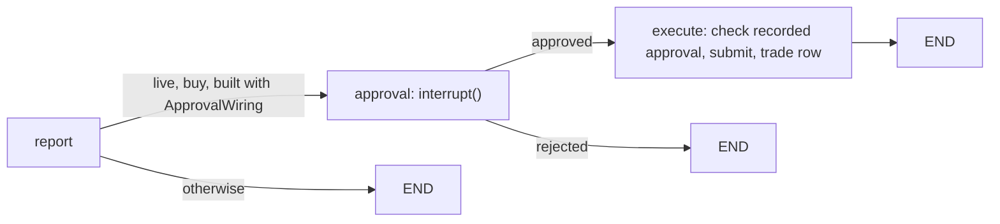

# M8 — Live mode: API, dashboard, approval, bracket orders, fill check: specs and plan

| | |
|---|---|
| **Status** | Revision 3, 2026-09-30. Revision 2: the owner asked for `task.md` and a crafted, interactive UI (Q1: yes); re-checked against the code and the installed libraries ([§7.1](#71-corrections-found-in-the-final-check)); UI design direction added ([§9.6](#96-ui-design-direction)). Revision 3: the owner chose **TradingView Lightweight Charts** over Recharts (deviation **D14**, D-M8-22) and asked for the remaining problems to be decided; the new dependencies were resolved for real (§7.1). Revision 4: the pre-start review found five gaps, now fixed and decided on the owner's instruction ([§7.2](#72-revision-4-gaps-found-in-the-pre-start-review), D-M8-25 to D-M8-31, review questions R1 to R5 in §8). [`task.md`](task.md) is updated to match. **Ready for the owner's green light** |
| **Date** | 2026-09-30 |
| **Size** | XL. Written as one `specs-plan.md` on the owner's instruction, as M3, M4 and M6 were (D-M8-1). [Dev-plan §1.2](../../dev-plan.md#12-per-milestone-documents) would otherwise ask for separate `specs.md` and `plan.md` |
| **Branch** | `m8-live-mode`, from `master` (M7 merged and tagged `m7`, merge `d61985e`) |
| **ADRs** | [ADR-0002: bracket order TIF and legs](../../adr/0002-bracket-order-tif-and-legs.md) (used as is); **ADR-0007: exit anchoring** (new, M8-AC-13) |
| **Depends on** | **M5** (report): accepted, tagged `m5`. **M6** (journal: `approvals`, `trades`, `equity_snapshots`; `OrderBroker`; `client_order_id`): accepted, tagged `m6`. M8 also reuses M4's `share_limits` and `shrink` and M7's results page. M7 isn't a dependency, but the Backtests page shows its results. M0's close-out (M0-T-18: close the spike's 1-share F position; M0-T-25) is still open and needs a market session; it can be done in the same session as M8-AC-6 |
| **Sources** | [dev-plan §5 M8](../../dev-plan.md#m8--live-mode-api-dashboard-approval-bracket-orders-fill-check), [§1.2](../../dev-plan.md#12-per-milestone-documents), [§2.1](../../dev-plan.md#21-toolchain), [§2.2](../../dev-plan.md#22-code-conventions), [§2.3](../../dev-plan.md#23-repository-layout), [§6.1](../../dev-plan.md#61-safety), [§7](../../dev-plan.md#7-testing-strategy), [§8](../../dev-plan.md#8-data-model-evolution), [§9](../../dev-plan.md#9-plan-level-risks), [§10](../../dev-plan.md#10-decisions-log) (Q6, Q10a), [§10.1](../../dev-plan.md#101-scope-review-revision-4) (C6, C9, C10, C11, C16); [architecture §4](../../architecture.md#4-system-overview), [§5](../../architecture.md#5-one-request-step-by-step), [Part 0](../../architecture.md#part-0--the-backbone-shared-state-and-graph-code), [Part 11](../../architecture.md#part-11--risk-manager-both) (loss warning), [Part 13](../../architecture.md#part-13--approval-gate-code), [Part 14 (Alpaca)](../../architecture.md#alpaca-paper-broker-live), [Part 15](../../architecture.md#part-15--trade-journal-code), [§7](../../architecture.md#7-the-report), [§8](../../architecture.md#8-live-mode), [§9](../../architecture.md#9-a-trades-life), [§13](../../architecture.md#13-tech-stack); [M0 findings](../M0-foundations/findings.md) A7–A9, A13; [ADR-0003](../../adr/0003-point-in-time-prices.md); M5 [specs-plan](../M5-report/specs-plan.md) (NFR-4, D-M5-10) and [retrospective](../M5-report/task.md#retrospective); M6 [specs-plan](../M6-backtest/specs-plan.md) (D-M6-2, D-M6-4, D-M6-5, D-M6-6, D-M6-16) and [retrospective](../M6-backtest/task.md#retrospective); M7 [retrospective](../M7-evaluation/task.md#retrospective) |

Part A says **what** M8 delivers and how it's accepted. Part B says **how** it gets built. Neither restates the architecture or the dev plan; they link to them.

---

## Contents

**Part A: Specs**: [1 Goal](#1-goal) · [2 Scope](#2-scope) · [3 Functional requirements](#3-functional-requirements) · [4 Non-functional requirements](#4-non-functional-requirements) · [5 Interfaces](#5-interfaces) · [6 Acceptance criteria](#6-acceptance-criteria) · [7 Decisions](#7-decisions-made-in-this-document) · [8 Open questions](#8-open-questions-for-the-owner)

**Part B: Plan**: [9 Module design](#9-module-design) · [10 Data model](#10-data-model) · [11 Key algorithms](#11-key-algorithms) · [12 Error handling](#12-error-handling) · [13 Tests and checks](#13-test-and-verification-plan) · [14 Work order](#14-work-order) · [15 Risks](#15-risks)

---

# Part A: Specs

## 1. Goal

The real product loop on Alpaca paper. The owner starts a request from the dashboard, reads the report, and approves or rejects it. The graph **pauses** for that decision and survives a restart while it waits. An approved buy becomes **one** bracket order on the paper account, with its stop-loss and take-profit left to the broker. A fill check records the entry, the exit and the profit or loss in the journal, and never touches the trade. The architecture's done-when: *"One live request is approved, fills, and later exits, all recorded."*

## 2. Scope

### 2.1 In scope

| # | Item | Source |
|---|---|---|
| S1 | `broker/alpaca.py` write side: `submit_bracket_order` (market, whole shares, GTC, stop and take-profit legs, `client_order_id` from `request_id`, idempotent) and `get_order` with its legs. `AlpacaBroker` becomes an `OrderBroker` | Part 14; ADR-0002; D-M6-2 |
| S2 | ADR-0007: exits are anchored to the reference price (the last close at `as_of`) in both modes, checked against Alpaca's leg validation with one real rejected order | dev-plan M8 |
| S3 | `approval/gate.py`: the owner's decision, shares that can only go down, the rules re-checked (net of pending orders, D-M8-25), the 2% staleness check, the one-trading-day expiry, the loss-warning confirmation. Pure | Part 13 |
| S4 | Graph: an `approval` node (`interrupt()`) and an `execute` node after the report, for live buys only, with a SQLite checkpointer | Part 13; §8 |
| S5 | Live request flow in `runners/request.py`: open, run to the pause, resume with the decision; the live loss warning from live `equity_snapshots`; live cash and position net of pending orders (D-M8-25); expiry that never loses a recorded approval (D-M8-27) | §5; C16 |
| S6 | `runners/fill_check.py` and `bullpit fill-check`: order and leg status → `trades`; live `equity_snapshots`; warnings for a trade without active exits | Part 14; C9, C16 |
| S7 | `data/prices.latest_price`: the latest trade price, for the staleness check only | Part 13 |
| S8 | `bullpit/api/` (FastAPI) and `bullpit serve` (bound to `127.0.0.1` only) | dev-plan M8; Q6 |
| S9 | `web/` (Next.js, TypeScript, App Router, TradingView Lightweight Charts, D-M8-22): New request, Report and decide, History, Trades, Backtests; every page with loading, error and empty states and basic accessibility | dev-plan M8; C6, C11 |
| S10 | API types generated from FastAPI's OpenAPI schema; CI builds the web app and fails if the generated types are stale | dev-plan §2.1; M8-AC-8 |
| S11 | Journal migration `0007` | dev-plan §8 |
| S12 | The real end-to-end paper trade (AC-6), and README sections for live mode | §16 |

### 2.2 Out of scope

- Hosting, authentication, more than one user (Q6: localhost only).
- A background scheduler for the fill check (C9).
- Theme switching and a mobile layout (C10). The visual style of the one theme is Q1.
- Starting backtests or evaluations from the dashboard; the dashboard only reads them. They stay CLI commands.
- Selling, closing or changing a position from the system (architecture §9: once approved, the system never touches the trade).
- Resuming a request that crashed **before** the approval pause; it is marked failed by the existing lock timeout, as today (D-M8-17).
- Partial fills beyond a warning (D-M8-19); fractional shares (ADR-0002).
- M7's carry-overs (full evaluation, repeat seeds, debate impact) and any LLM, prompt or agent change. M8 adds **no** LLM call.
- Masking the one M4 warning that quotes LLM text (M5 carry-over): M8 doesn't touch warnings. It stays a carry-over.

## 3. Functional requirements

**Alpaca write side (architecture Part 14; ADR-0002)**

- **M8-FR-1 Submit.** `AlpacaBroker.submit_bracket_order(order, client_order_id, submitted_on)` sends one market buy of `order.shares` whole shares, `time_in_force = GTC`, `order_class = bracket`, take-profit limit `order.take_profit` and stop `order.stop_loss` (both already whole cents), with the given `client_order_id`. It returns a `Trade` with status `pending` and the Alpaca order and leg IDs.
- **M8-FR-2 Idempotent submit.** If Alpaca answers `client_order_id must be unique`, or the call fails in a way that leaves it unknown whether the order was accepted (timeout, connection error, 5xx), the broker looks the order up by `client_order_id` and returns it. Only if no such order exists does it raise `BrokerRejected` with Alpaca's message ([§11.3](#113-idempotent-submit)).
- **M8-FR-3 Read an order.** `get_order(client_order_id)` reads the order with its legs and maps it to a `Trade` ([§11.4](#114-alpaca-order-to-trade)): `pending` (entry not filled), `open` (entry filled, no leg filled), `closed` (a leg filled: exit reason `stop` or `target`, exit price the leg's average fill price), `cancelled` (entry cancelled, expired or rejected, with the reason). Entry and exit dates are the New York date of the fill.
- **M8-FR-4 Paper only.** The write side is reached only through `make_trading_client`, so the M0 paper guard runs before any order call. Nothing in M8 adds a way around it.

**Approval gate (architecture Part 13)**

- **M8-FR-5 Pause.** A live request whose outcome is `buy` stops at the `approval` node after its report is built. The graph state is checkpointed in SQLite under the thread ID `request_id`. The request row, its signals, debate, recommendations and report are written as for any request, with status `awaiting_approval`. The pause survives an API restart (AC-1).
- **M8-FR-6 Decision checks.** `POST /requests/{id}/approval` takes `approve` (with an optional share count, default the recommended one) or `reject`. Code checks, in this order, and refuses with a typed problem at the first failure ([§11.2](#112-approval-checks)):
  1. The request is `awaiting_approval` (otherwise `not_awaiting`).
  2. It hasn't expired (FR-9; otherwise it is marked `expired` and refused).
  3. **Approve only:** the share count is a whole number from 1 to the recommended shares. **More than recommended is refused by the API**, whatever the UI sends (AC-2).
  4. **Approve only, staleness:** code fetches the latest price (FR-12). If it moved more than `approval_staleness_pct` (2%) from the report's reference price, the approval is refused with both prices and the move, unless the request says `confirm_stale` (AC-3). The owner can instead reject and start a new request (re-run).
  5. **Approve only, loss warning:** if the report's loss warning is `True`, the approval is refused unless the request says `confirm_loss_warning` (AC-10).
  6. **Approve only, rules re-checked:** the latest price must be strictly between the stop and the take-profit, or the bracket would exit at once (D-M8-28). Then, with a fresh account and position **net of pending orders** (FR-29) at the latest price, `shares × latest price ≤ cash` (never buying power) and the position after the trade stays within the per-stock cap. A failure is refused with the reason and the largest share count that would pass (D-M8-7).
- **M8-FR-7 Record, then order.** A decision that passes is written to `approvals` (`decided_by = owner`, recommended and approved shares, the wall-clock decision time, the latest price, the confirmations given) and **committed before the graph resumes**. The `execute` node places an order only if that row exists, says `approved`, and has the same share count (dev-plan §6.1). The order is `shrink(order, shares)`: the same stop and take-profit, with cost, maximum loss and gain recomputed; it can never grow.
- **M8-FR-8 Execute.** The `execute` node submits with `client_order_id(request_id)`, writes the `trades` row (`run_id` NULL, with the order and leg IDs) and marks the request `completed`, in one transaction after the submit. A `BrokerRejected` marks the request `failed` with Alpaca's message; the `approvals` row stays, because it records what the owner decided. A **reject** resumes the graph to its end: request `completed`, `approvals.decision = rejected`, no order.
- **M8-FR-9 Expiry.** A report can be approved until the **close of the first trading session after its `as_of`** (D-M8-5). After that it's `expired`: it can't be approved or rejected, and it no longer holds the lock. Expiry is applied when the request is read, when an approval is tried, and when a new request takes the lock, by one function (`expire_overdue`). **A recorded approval is never expired blindly** (D-M8-27): if the request has an `approved` row but no trade row (the process died between the commit and the order), expiry first looks the order up by `client_order_id`. Found → the trade row is written and the request `completed`. Not found → `expired` with the reason *"Approved, but no order was placed before the report expired."* (the `approvals` row stays; no order is placed on an out-of-date report). Alpaca unreachable → the row is left as it is and tried again next time.
- **M8-FR-10 Repeats and races.** A second approval for a `completed` request is refused (`not_awaiting`) and the response names the existing decision and trade; no second order. A request whose decision is recorded but whose order step didn't finish (the process died in between) is finished by sending the approval again: the recorded decision is used, whatever the body says, and `client_order_id` makes at most one order (AC-5). Two approvals at the same moment: the unique `approvals.request_id` lets one through; the other is refused. Approvals for **different** requests are handled one at a time by a lock in the API process (one process, one worker), so each re-check sees the pending order the previous approval placed (D-M8-30).
- **M8-FR-11 Duplicate lock.** The per-ticker lock (M3-FR-3) now covers `running` **and** `awaiting_approval`: a new live request for a ticker whose report is waiting for a decision is refused with *"A report for AAPL is waiting for your decision."* (D-M8-6). The `running` timeout is unchanged.
- **M8-FR-29 Pending orders count (D-M8-25).** An approved order that hasn't filled is invisible in Alpaca's `cash` and positions, and Alpaca's buying power would accept a second order on the same cash. So every live read of the account, in the request check (API and CLI) and in the approval re-check, is net of the live trades still `pending` in the journal, as the simulated broker already does (M6): `cash` minus `shares × reference_price` of every pending trade, and the position in the requested ticker plus its pending shares at their reference price. `equity` is unchanged (the cash hasn't been spent). A pending trade that has filled but isn't yet recorded is counted twice until the next fill check, which only ever refuses more, never less; the `rules` refusal says to run the fill check.

**Latest price**

- **M8-FR-12** `data/prices.latest_price(symbol, settings=...)` returns the price of the latest trade from Alpaca's data API (IEX feed, free plan) as a `Decimal`. It is live-only, is used only by the approval check, and never reaches an agent or a backtest. Failure → `DataUnavailable`, and the approval is refused (`price_unavailable`) rather than approved without the check.

**Fill check (architecture Part 14; C9, C16)**

- **M8-FR-13 Trades.** For every live trade that isn't `closed` or `cancelled`, the fill check reads the order through `get_order` and updates the `trades` row: entry date and price, shares actually filled, exit date, price and reason, P&L = (exit − entry) × shares. It only records: it never places, cancels or changes an order.
- **M8-FR-14 Manual close.** An `open` trade whose legs were both cancelled (none filled, none active) and after which a sell of that ticker filled was closed by hand (architecture §9). It's recorded `closed` with exit reason `manual`, at the price and date of the **first filled sell of that ticker that isn't a bracket leg, filled at or after the later leg's cancel time** (D-M8-10). The rule reads orders only, so it works whether or not other shares of the ticker are held. Legs cancelled and no such sell → the trade stays `open` and the check reports *"open trade without active exits"* (dev-plan §9 risk).
- **M8-FR-15 Equity.** The fill check upserts live `equity_snapshots` rows (`run_id` NULL, one per session date) from Alpaca's daily portfolio history, from the last session on or before `as_of − loss_warning_days` through the latest one (D-M8-9).
- **M8-FR-16 When it runs.** `POST /fill-check`, `bullpit fill-check`, and the dashboard calls it once each time it's opened. No scheduler (C9). It returns the trades it changed, the snapshots written, and its warnings.
- **M8-FR-17 Live loss warning (C16).** Before a live request's graph runs, `RequestState.loss_warning` = `loss_warning(live snapshots, as_of, …)`, or `None` if the history doesn't reach back far enough. The report shows it (section 6), and FR-6.5 enforces it.

**API (FastAPI, localhost, single user)**

- **M8-FR-18 Endpoints.**

  | Method and path | Does | Success | Refusals |
  |---|---|---|---|
  | `POST /requests` `{ticker}` | Trims and upper-cases the ticker, takes the lock for a live request at `LiveClock().as_of()`, then runs the graph in a background thread | 202 `{request_id}` | 409 duplicate; 422 ticker (after trimming and upper-casing) not `^[A-Z][A-Z.]{0,9}$` |
  | `GET /requests?limit=` | Newest first | 200 list | — |
  | `GET /requests/{id}` | Status, progress stage (§11.6), rejection or failure reason, `expires_at`, the decision and the trade if any | 200 | 404 |
  | `GET /requests/{id}/report` | The stored `Report` JSON | 200 | 404 (unknown, or no report yet) |
  | `POST /requests/{id}/approval` | FR-6 to FR-10 | 200 `{approval, trade}` | 404; 409 with a problem (FR-6); 422 body invalid |
  | `GET /trades` | Live trades, newest first | 200 list | — |
  | `GET /equity` | Live equity snapshots, oldest first | 200 list | — |
  | `POST /fill-check` | FR-13 to FR-16 | 200 summary | 502 if Alpaca can't be reached |
  | `GET /backtests` | Backtest runs with their policy, window, status and last equity | 200 list | — |
  | `GET /backtests/{id}/results` | One run: inputs, status, its trades and equity series, from the journal | 200 | 404 |
  | `GET /results` | M7's `results.md` text and the names of its chart images | 200 | 404 if no results yet |
  | `GET /results/files/{name}` | One chart image from the results directory | 200 PNG | 404 |

- **M8-FR-19 Errors.** Every refusal is JSON `{code, message, ...details}` with a stable `code`. No stack trace, no key, no config snapshot ever appears in a response.
- **M8-FR-20 Serve.** `bullpit serve` upgrades the journal schema, opens the checkpointer, and runs the API on **`127.0.0.1`** (fixed in code, not a setting) at `api_port`. One process, one worker.
- **M8-FR-21 OpenAPI.** `bullpit openapi --out PATH` writes the API's OpenAPI schema as UTF-8 JSON with LF line endings (for type generation, FR-25; D-M8-24).

**Dashboard (`web/`)**

- **M8-FR-22 Pages.**

  | Page | Shows and does |
  |---|---|
  | **New request** (`/`) | A ticker input and Start. While the request check runs, the page waits on it; a rejection or duplicate is shown inline under the input. Otherwise it opens the request's report page |
  | **Report and decide** (`/requests/[id]`) | While running: the progress stage. Then the 10-section report rendered from the `Report` object ([architecture §7](../../architecture.md#7-the-report)). For a buy awaiting a decision: a share count that can only go down (max = recommended), Approve and Reject, the expiry time, and the confirmation dialogs the API asks for (stale price, loss warning, rules). After a decision: the decision and the order's status |
  | **History** (`/requests`) | Past requests (ticker, `as_of`, status, outcome, decision), each linking to its report |
  | **Trades** (`/trades`) | Open and closed live trades, exit reasons, P&L; the live equity chart (TradingView Lightweight Charts, with a text summary and a data-table view for screen readers); a "Check fills" button |
  | **Backtests** (`/backtests`) | Runs from the journal, each expandable to its trades; M7's results table and its three chart images, not redrawn (C6) |

  Opening the dashboard runs the fill check once (FR-16).
- **M8-FR-23 States and accessibility (C11).** Every page and data panel has a loading state, an error state that shows the API's message, and an empty state that says what to do next. Every input has a label, everything can be reached and used with the keyboard, focus is visible, and dialogs trap focus and close on Escape.
- **M8-FR-24 One way to the API.** The web app calls the API only through a same-origin `/api/*` rewrite to `127.0.0.1:<api_port>`, so the API needs no CORS. The Next.js server binds to `127.0.0.1`.
- **M8-FR-25 Generated types.** The web app's API types are generated from the OpenAPI schema with `openapi-typescript` and committed; there are no hand-written copies of API shapes.

**CLI**

- **M8-FR-26** `bullpit request` in live mode is unchanged: it builds the graph without the approval step, so it never pauses and never places an order. The dashboard is the only way to an order (architecture §4, D-M8-2). New commands: `bullpit serve`, `bullpit fill-check`, `bullpit openapi`.

**Settings and journal**

- **M8-FR-27** New settings in `config.py` and `.env.example`: `approval_staleness_pct` = 0.02, `api_port` = 8000, `checkpoint_db_path` = `checkpoints.db`, `results_dir` = `docs/results` (also the `bullpit eval` default, so the fact lives in one place).
- **M8-FR-28** Migration `0007_live` ([§10](#10-data-model)).

## 4. Non-functional requirements

- **M8-NFR-1 (tests)** [Dev-plan §7](../../dev-plan.md#7-testing-strategy) exactly: the safety refusals (can't raise shares, one order per approval, no order without a recorded approval) and the staleness and expiry checks get tests (§7.1, and the dev-plan's own AC-3 "tested with a fake price source"); each API endpoint gets one happy path (§7.2); the dashboard is clicked through by hand (§7.3). No network (`pytest-socket`); the suite stays under about a minute.
- **M8-NFR-2 (pure core)** `approval/gate.py` does no I/O, reads no settings and never reads the clock: `now`, the latest price, the account and the position are passed in. The Alpaca order-to-trade mapping is a pure function. I/O stays in `broker/`, `data/`, `journal/`, `runners/` and `api/`.
- **M8-NFR-3 (money)** Prices, costs, cash and P&L are `Decimal` in the gate, the broker, the fill check and the journal; Alpaca's strings are converted with `Decimal(str(x))` and rounded to the cent; shares are integers.
- **M8-NFR-4 (time)** The API takes its `now` from `clock.utc_now` (injected, so tests fix it), and every expiry decision (`expire_overdue`, `check_decision`) uses that injected `now`; the report's `generated_at` stays display-only. Expiry and fill dates come from the NYSE calendar. `as_of` is `LiveClock().as_of()`.
- **M8-NFR-5 (safety)** Paper guard unchanged; no order without a committed owner approval; shares can only go down; one order per `client_order_id`; the API binds to loopback only; secrets never appear in responses or logs.
- **M8-NFR-6 (tokens)** M8 adds no LLM call. A live request costs what M5 measured (~15K tokens when debated).
- **M8-NFR-7 (machine)** One API process and one Next.js process fit the 8 GB laptop next to the browser. A request runs in one background thread; several tickers can run at once, and the gateway's pacing is shared.
- **M8-NFR-8 (browser)** Current Chrome or Edge on a laptop screen. No mobile layout (C10).

## 5. Interfaces

```python
# bullpit/domain.py (+)
ExitReason = Literal["stop", "target", "window_end", "manual"]
class Trade(BaseModel, frozen=True):        # M6 fields, plus (None in the simulated broker):
    order_id: str | None = None
    stop_order_id: str | None = None
    take_profit_order_id: str | None = None

# bullpit/broker/alpaca.py (+): AlpacaBroker now implements OrderBroker
class LiveOrder(BaseModel, frozen=True):
    trade: Trade
    exits_active: bool                       # a leg is new, accepted, held or pending
    exits_cancelled_at: datetime | None      # both legs cancelled, none filled: the later cancel time
    partial: bool                            # the entry or a leg is partially filled
def live_order(order: alpaca.trading.models.Order, *, submitted_on: date,
               reference_price: Decimal) -> LiveOrder: ...          # pure (§11.4)
class AlpacaBroker:
    def submit_bracket_order(self, order: SizedOrder, *, client_order_id: str,
                             submitted_on: date) -> Trade: ...     # FR-1, FR-2
    def get_order(self, client_order_id: str) -> Trade: ...        # FR-3; unknown → BrokerRejected
    def find_order(self, client_order_id: str, *, submitted_on: date,
                   reference_price: Decimal) -> LiveOrder | None: ...  # 404 → None (FR-2, FR-9)
    def get_live_order(self, trade: Trade) -> LiveOrder: ...       # for the fill check
    def first_sell_fill(self, symbol: str, after: datetime
                        ) -> tuple[date, Decimal] | None: ...       # non-leg sells only (FR-14)
    def equity_history(self, start: date) -> list[tuple[date, Decimal]]: ...

# bullpit/data/prices.py (+)
def latest_price(symbol: str, *, settings: Settings) -> Decimal: ...   # live only (FR-12)

# bullpit/approval/gate.py (pure; + to M6's backtest_policy)
class ApprovalDecision(BaseModel, frozen=True):
    decision: Literal["approved", "rejected"]
    recommended_shares: int
    approved_shares: int
    decided_by: Literal["backtest_policy", "owner"]
    latest_price: Decimal | None = None
    confirmations: list[Literal["stale", "loss_warning"]] = []

class OwnerDecision(BaseModel, frozen=True):        # the approval request body
    decision: Literal["approve", "reject"]
    shares: int | None = None
    confirm_stale: bool = False
    confirm_loss_warning: bool = False

ProblemCode = Literal["not_awaiting", "expired", "shares_invalid", "price_unavailable",
                      "stale", "loss_warning", "rules"]
class ApprovalProblem(BaseModel, frozen=True):
    code: ProblemCode
    message: str
    report_price: Decimal | None = None
    latest_price: Decimal | None = None
    move_pct: Decimal | None = None
    max_shares: int | None = None

def expires_at(as_of: date) -> datetime: ...       # close of the first session after as_of
def check_decision(body: OwnerDecision, order: SizedOrder, *, as_of: date, now: datetime,
                   latest_price: Decimal | None, loss_warning: bool | None, account: Account,
                   held_value: Decimal, staleness_pct: Decimal, cap_pct: Decimal
                   ) -> ApprovalDecision | ApprovalProblem: ...    # FR-6 steps 2-6; account and
                                                   # held_value already net of pending (FR-29)

# bullpit/state.py (+)
class RequestState(BaseModel):                     # existing fields, plus:
    approval: ApprovalDecision | None = None       # architecture Part 0
    trade: Trade | None = None

# bullpit/graph.py (+)
@dataclass(frozen=True)
class ApprovalWiring:
    checkpointer: BaseCheckpointSaver[str]
    broker: OrderBroker
def build_graph(deps: Deps, *, policy: Policy = "bullpit", buy_decisions: ... = None,
                approval: ApprovalWiring | None = None) -> CompiledStateGraph[...]: ...
                                                   # approval=None: the M7 graph, unchanged

# bullpit/risk/sizing.py (+; pure)
def net_of_pending(account: Account, held_value: Decimal, pending: list[Trade], ticker: str
                   ) -> tuple[Account, Decimal]: ...   # FR-29: cash − pending cost; held + pending in ticker

# bullpit/runners/request.py (+); run_request keeps its behaviour, built from these
@dataclass(frozen=True)
class PendingAwareBroker:                          # Broker; wraps AlpacaBroker for live reads (FR-29)
    broker: AlpacaBroker
    sessions: sessionmaker[Session]                # reads pending live trades on every call
def expire_overdue(*, sessions: sessionmaker[Session], broker: AlpacaBroker, now: datetime,
                   ticker: str | None = None, request_id: str | None = None) -> None: ...
                                                   # FR-9, D-M8-27: the one place expiry is applied
def open_request(ticker: str, mode: Literal["live", "backtest"], as_of: date, *,
                 settings: Settings, sessions: sessionmaker[Session],
                 broker: AlpacaBroker | None, now: datetime) -> RequestState: ...
                                                   # cutoff check + expire_overdue (live) + lock;
                                                   # rejection set if refused
def run_live(state: RequestState, graph: CompiledStateGraph[...], *,
             settings: Settings, sessions: sessionmaker[Session]) -> RequestState: ...
                                                   # to the pause or the end; journal rows
def resume_live(request_id: str, decision: ApprovalDecision, graph: CompiledStateGraph[...]
                ) -> RequestState: ...             # after the approvals row is committed

# bullpit/runners/fill_check.py
class FillCheckResult(BaseModel, frozen=True):
    changed: list[Trade]
    snapshots: int
    warnings: list[str]
def fill_check(*, broker: AlpacaBroker, sessions: sessionmaker[Session], as_of: date,
               settings: Settings) -> FillCheckResult: ...

# bullpit/api/app.py
def create_app(settings: Settings, *, broker: AlpacaBroker, sessions: sessionmaker[Session],
               checkpointer: BaseCheckpointSaver[str], now: Callable[[], datetime] = utc_now,
               completion_fn: CompletionFn = litellm_completion,
               latest_price: Callable[[str], Decimal] = ...) -> FastAPI: ...
```

`bullpit/api/schemas.py` holds the response bodies (request summary and detail, approval result, trade, equity point, fill-check summary, backtest run and detail, results page). They reuse `Report`, `Trade`, `ApprovalDecision` and `ApprovalProblem` rather than copying them.

## 6. Acceptance criteria

| AC | Criterion | Verified by |
|---|---|---|
| **M8-AC-1** | A request started through the API reaches `awaiting_approval` with its report. A **new** app instance over the same journal and checkpoint files (a restart) still shows it waiting, and approving it there places the order and completes the request | **Automated** (two app instances, fake LLM, fake broker) + Manual (real restart of `bullpit serve` during AC-6) |
| **M8-AC-2** | Approving more shares than recommended, 0 shares, or a non-integer is refused **by the API** (`shares_invalid`, no order, no `approvals` row); a lower count is accepted and the order is rebuilt smaller with the same exits | **Automated** |
| **M8-AC-3** | With a fake price source: a move above 2% from the reference is refused as `stale` with both prices; the same approval with `confirm_stale` goes through and records the confirmation and the latest price; a move of exactly 2% needs no confirmation; a price-source failure is refused as `price_unavailable` | **Automated** |
| **M8-AC-4** | A report with `as_of` 2024-11-27 can be approved until the 2024-11-29 early close (18:00 UTC) and not after: the request becomes `expired`, can't be decided, and a new request for the same ticker can take the lock | **Automated** |
| **M8-AC-5** | One order per approval: (a) the same approval sent twice gives one submit and the second is refused with the existing decision; (b) a decision recorded with the process "dying" before the order step, then sent again, gives exactly one submit; (c) a submit that Alpaca answers with *client_order_id must be unique* returns the existing order; (d) resuming the graph with an approval payload but **no** committed `approvals` row places no order; (e) a recorded approval with no trade row, once the report has expired: an order Alpaca already has is recorded and the request `completed`; with no such order the request is `expired` with the D-M8-27 reason, and nothing is submitted | **Automated** |
| **M8-AC-6** | **End to end on Alpaca paper:** one real request from the dashboard is approved, the bracket order is placed (IDs visible in Alpaca's dashboard), the entry fills, and later one exit fills and the broker cancels the other; each step is recorded by the fill check (`trades` row: entry, exit, reason, P&L; `approvals` row). Takes calendar time; may finish during M9 | Manual: dashboard screenshots, Alpaca order view and journal queries pasted in `task.md` |
| **M8-AC-7** | A position closed by hand is recorded on the next fill check as `closed`, exit reason `manual`, at the closing sell's price (FR-14's rule, including when other shares of the ticker are still held). Automated on recorded Alpaca order shapes; plus once for real on a second small paper trade closed from Alpaca's dashboard (may finish during M9) | **Automated** + Manual |
| **M8-AC-8** | CI lints the web app (`npm run lint`), builds it (`npm run build`, which type-checks), and regenerates the API types from `bullpit openapi`; a stale committed schema or type file fails CI | **Automated** (CI) |
| **M8-AC-9** | `alembic upgrade head` on an empty DB matches `models.py` (the existing migration test, covering `0007`) | **Automated** |
| **M8-AC-10** | Live snapshots showing equity down more than 5% over 7 days give a new live request `loss_warning = True` in its report, and its approval is refused as `loss_warning` until confirmed | **Automated** |
| **M8-AC-11** | Every API endpoint's happy path, on fixtures, the fake LLM and the fake broker | **Automated** |
| **M8-AC-12** | Every page works as FR-22 says, with its loading, error and empty states, labels and keyboard use (C11): clicked through by the owner against a running API | Manual: owner click-through, notes in `task.md` |
| **M8-AC-13** | ADR-0007 (exit anchoring) is written and includes one real probe: a 1-share bracket on a low-priced stock whose stop is above the current price, submitted through `AlpacaBroker` in market hours. **Either outcome is evidence** (D-M8-29): if Alpaca rejects it, its text and the `failed` message the API would show; if it accepts it, how the entry and the stop filled (and anything left open is cancelled). The ADR states the observed rule and why the gate's price-between-exits check (FR-6.6, D-M8-28) keeps this case away from the dashboard | Manual: owner reads it |
| **M8-AC-14** | The API binds only to `127.0.0.1`; no response or log line contains a key; `bullpit doctor` passes | Manual (checked once, pasted) |
| **M8-AC-15** | Pending orders count (FR-29): with one approved order still `pending`, (a) a second approval whose cost fits Alpaca's cash but not cash net of the pending order is refused as `rules` with `max_shares`; (b) a new request for the same ticker is sized with the pending shares counted in the per-stock cap | **Automated** (gate level: `net_of_pending`; API level: two approvals) |

AC-1 to AC-8 are the dev-plan's drafts made concrete; AC-9 covers the journal, AC-10 the live loss warning (C16), AC-11 §7.2's endpoint happy paths, AC-12 C11, AC-13 the dev-plan's exit-anchoring ADR, AC-14 the safety notes, AC-15 the cash and cap rules across orders that haven't filled.

## 7. Decisions made in this document

None of these changes the system's behaviour. **D-M8-22** changes the tech stack named in architecture §13 and dev-plan §2.1 (Recharts → TradingView Lightweight Charts), so it becomes deviation **D14** in dev-plan §3 and architecture revision **v2.6**. D-M8-12 changes dev-plan §2.3's layout (`api/` → `bullpit/api/`) and D-M8-8 refines §8's note on checkpoint tables. The same v2.6 entry brings the architecture's own text in line, with no behaviour change: §15's project structure (`bullpit/api/`), Part 15's exit reasons (+ `manual`, which §9 already describes) and §13's database row (checkpoints in their own SQLite file). D-M8-25 and D-M8-28 aren't deviations: they are how "never more than your available cash", "including any shares you already hold" (Part 11) and "code re-checks the rules" (Part 13) hold while an order is still pending. All are written in task 1.

| # | Decision | Reason |
|---|---|---|
| D-M8-1 | **One `specs-plan.md`** for this XL milestone | The owner asked for it, as for M3, M4 and M6. Same content as `specs.md` + `plan.md` |
| D-M8-2 | **The approval pause and the order are graph nodes (`approval`, `execute`), added only when the graph is built with an `ApprovalWiring`.** The API builds it that way; `bullpit request`, the backtest runner and M7's policies don't, so their graphs are unchanged and live CLI requests never order | Architecture §8 shows the graph pausing and then submitting the order. Wiring it only for the API keeps the backtest path (D-M6-4) and every existing test untouched, and makes the dashboard the one way to an order |
| D-M8-3 | **The decision checks run in the API, before the graph resumes; the `execute` node re-checks only that a matching approval is committed** | The staleness check needs a round trip to the owner (confirm or re-run), which a node can't do. LangGraph re-runs an interrupted node from its start on resume, so the `approval` node must have no side effects; keeping checks in the pure gate and the one I/O step in `execute` respects that |
| D-M8-4 | **The approval is committed before the order; `execute` submits and writes the trade row itself; submit is idempotent** | Dev-plan §6.1: no order without a recorded approval. If the process dies anywhere, re-sending the approval finishes the job with at most one order, because `client_order_id` is fixed and Alpaca enforces it (ADR-0002) |
| D-M8-5 | **Expiry = the close of the first session after `as_of`** | "Expires after one trading day, because its prices are out of date": the report's prices are the close of `as_of`, so they're good for one more session. A request on Saturday can be approved until Monday's close (the order would fill at Monday's open anyway). A request made during Monday's session has `as_of` Friday and expires at Monday's close: short, but its price is already a day old, and the staleness check covers the rest |
| D-M8-6 | **The duplicate lock covers `awaiting_approval`** | A waiting buy isn't in the account yet, so a second request for the same ticker would size against a position that doesn't count it, and two approvals could pass the 10% cap together. Refusing it until a decision or expiry is the simplest safe rule. Once approved, the order is `pending` and D-M8-25 counts it, so the lock can be released |
| D-M8-7 | **At approval the cash and cap rules are re-checked with a fresh account and position at the latest price; a failure is refused, not shrunk automatically, with the largest passing share count in the response** | Part 13: "code re-checks the rules on any change". The account can change while a report waits (another approval, a manual trade). Cash, never buying power (M0 A13: 4× margin would hide a shortfall). Refusing keeps the owner in charge of the number |
| D-M8-8 | **LangGraph checkpoints go in their own SQLite file (`checkpoints.db`)**, not the journal | The checkpointer creates and migrates its own tables. In the journal, Alembic's schema check and future autogenerated migrations would see foreign tables. A separate file keeps the journal exactly what `models.py` says; both stay local SQLite (architecture §13) |
| D-M8-9 | **Live equity snapshots come from Alpaca's daily portfolio history, fetched by the fill check** | C16 asks the fill check to take live snapshots. Reading Alpaca's own daily equity means a day the dashboard wasn't opened still has its close, so the 7-day loss warning compares real closes, not whenever the owner happened to look |
| D-M8-10 | **Manual close = entry filled, both legs cancelled with none filled, and a non-leg sell of the ticker filled at or after the later cancel time; exit at the first such sell.** Several trades in one ticker closed by the same sell all close at its price (revision 4: no longer requires the position to be gone) | Closing from Alpaca's dashboard cancels the bracket legs and then sells, and Alpaca refuses a sell of shares still held for open legs, so the closing sell always follows the cancel. Reading orders, not the position, keeps the rule right when the owner holds other shares of the ticker (the architecture allows that), where a "no position" test would leave the trade `open` for ever. Anything it can't explain is a warning, not a guess (architecture §9: "the system simply records it") |
| D-M8-11 | **The staleness price is Alpaca's latest trade on the IEX feed** | Free plan, real time, same provider as the orders. It's live-only and never reaches an agent, so the date guard doesn't apply; it lives in `data/prices.py` because the data layer is the only door to outside data |
| D-M8-12 | **The API is `bullpit/api/`, not a top-level `api/`** | Inside the package it is installed, type-checked by `mypy bullpit`, and covered by the same import rules. A top-level folder would be outside the wheel and outside CI's type check |
| D-M8-13 | **`bullpit serve` binds `127.0.0.1` in code; there is no host setting** | Q6: localhost only, no auth. A setting would be a way to expose an unauthenticated order endpoint by mistake |
| D-M8-14 | **The web app reaches the API through a Next.js rewrite of `/api/*`** | Same-origin calls need no CORS setup, and the browser never sees the API's port |
| D-M8-15 | **Backtests page reads the journal and serves M7's results page as it is (Markdown text and the PNGs); no metric is recomputed; `results_dir` is a setting shared with `bullpit eval`** | C6: charts are made once in M7. Recomputing metrics in the API would duplicate `eval/` and need price data |
| D-M8-16 | **`bullpit openapi --out` writes the schema; `openapi-typescript` generates `web/src/api/schema.d.ts`; both the schema and the types are committed and CI regenerates and diffs them** | M8-AC-8: types from OpenAPI, no hand-written copies. A CLI command works the same on Windows and in CI (CLAUDE.md: helper scripts are Python, not shell) |
| D-M8-17 | **Progress comes from the checkpointer (the next node and the state so far), not a new table. A request that dies before the pause isn't resumed**; the existing lock timeout marks it failed | The checkpointer already saves after every step. Resuming crashed runs is new behaviour nobody asked for; the owner can simply start again |
| D-M8-18 | **The dashboard starts live requests only**; backtests and evaluations stay CLI | Architecture §4: requests start from the dashboard; backtests run for days on quota and are managed with `--resume` |
| D-M8-19 | **Partial fills are reported as warnings and the trade stays `pending` or `open`** | Market orders of a few shares of a large cap fill whole in practice; handling partials properly is money code nothing here would exercise |
| D-M8-20 | **`Trade` gains three optional Alpaca IDs and `ExitReason` gains `manual`** | Dev-plan §8 names the order and leg IDs; one `Trade` type keeps one mapping for both brokers (the simulated one leaves them `None`) |
| D-M8-21 | **Testing follows dev-plan §7 exactly** (D-M5-11 carries on). The Alpaca order mapping gets one parametrised test on recorded order shapes | A wrong mapping silently corrupts the live track record, which the architecture calls "your cleanest evidence" (§11), so it falls under §7.1's "silently corrupt results" |
| D-M8-22 | **The live equity chart uses TradingView Lightweight Charts (v5), not Recharts** (owner, Q2). Deviation **D14**: architecture §13's dashboard row and dev-plan §2.1's frontend row change; C6's "Recharts stays for the live equity chart" now reads Lightweight Charts. M7's backtest charts stay PNGs (C6 otherwise unchanged) | A trading-grade chart (pan, zoom, crosshair, markers) that suits the product. Apache-2.0, free, no API key. The chart only displays numbers the API already computed, so no behaviour changes. Its canvas isn't readable by screen readers, so a text summary and a table view come with it (C11) |
| D-M8-23 | **`openapi-fetch` is the web app's API client** | It types every call from the generated `schema.d.ts`, so paths, bodies and responses can't drift from the API, in less code than a hand-written helper. Same author as `openapi-typescript` |
| D-M8-24 | **Next.js 16: lint runs ESLint directly (`npm run lint`), separately from `npm run build`; `bullpit openapi` writes its file itself with LF endings** | Next 16 removed `next lint` and no longer lints during a build, so CI needs its own lint step for AC-8. PowerShell's `>` writes UTF-16 and Windows checkouts may use CRLF; writing the file in Python makes the committed schema byte-identical on Windows and in CI |
| D-M8-25 | **Live account reads are net of pending orders** (FR-29): a pure `net_of_pending` in `risk/sizing.py`, applied through a `PendingAwareBroker` wrapper that the live graph's request check and the approval re-check both use; the pending cost is `shares × reference_price`, exactly as `SimBroker._reserved()` does | Without it, an approved order that fills at the next open is invisible to the next request or approval: the 10% cap and the cash rule can both be broken, and Alpaca's 4× buying power (M0 A13) would accept the order. The backtest already reserves pending cash, so this also keeps the two modes the same (architecture §4). The wrapper is the one injection point that reaches the unchanged M3 request check; the pending position also counts toward the cap, which the backtest never needs because its next request on a ticker comes a week later, after the fill. Counting a filled-but-unrecorded order twice is the safe direction and lasts only until the next fill check |
| D-M8-26 | **API-level tests only where the API adds something the gate test can't show** (dev-plan §7, D-M8-21): the restart, "refused by the API" (the dev plan's own wording for AC-2), one order per approval, the live loss warning's wiring, the lock freed by expiry, pending orders across two approvals. Staleness and its confirmation are tested in the gate; the API happy path approves with a confirmed stale price and checks the recorded `latest_price` and `confirmations`, so the separate `test_stale_then_confirmed` is dropped | Revision 3 tested AC-2, AC-3, AC-4 and AC-10 twice. CLAUDE.md asks for necessary testing only; each API test left proves a wiring or a database property a bug there would break silently |
| D-M8-27 | **Expiry never drops a recorded approval without asking Alpaca** (FR-9) | A crash between the approval commit and the journal's trade row can leave a real order on Alpaca with nothing in the journal. Expiring blindly would lose that trade from the live record; placing a new order after expiry would trade on an out-of-date report. Looking the order up by its fixed `client_order_id` resolves both: record what exists, place nothing new |
| D-M8-28 | **The gate refuses an approval when the latest price is at or below the stop or at or above the take-profit** (`rules`), even with `confirm_stale` | Either way the bracket would exit on its first tick: a guaranteed loss or a pointless round trip. It mirrors Alpaca's own bracket rule (stop below and target above the base price), so the dashboard never sends an order Alpaca may reject or fill badly. Revision 3 had the stop side only |
| D-M8-29 | **AC-13 is a probe with both outcomes defined, not a test that assumes a rejection** | M0 (A7) saw only "take-profit must be above stop", with the market closed. In market hours Alpaca may reject a stop above the price, or accept it and fill both sides at once. The ADR needs the real rule, whichever it is; 1 share of a low-priced stock keeps a paper round trip to cents |
| D-M8-30 | **Approvals are handled one at a time** (a `threading.Lock` in `create_app` around the whole approval handler) | Two approvals for different tickers in the same moment would each re-check against cash before the other's pending trade exists. One process with one worker (FR-20) makes an in-process lock enough; approvals take about a second |
| D-M8-31 | **Task 14 is split in two (reading the report, then deciding on it), and `@number-flow/react` is dropped** | Revision 3's task 14 held the whole report page with ten signature components, far over half a day. Splitting at the read/decide line gives two reviewable tasks without throwaway work. Number animation is done with `motion`'s `animate`, already a dependency, so one package fewer (CLAUDE.md: no dependency without need) |

### 7.1 Corrections found in the final check

Checked line by line against the M0–M7 code and the installed `langgraph` 1.2.12, `langgraph-checkpoint` 4.2.0 and `alpaca-py` 0.44.0 before writing `task.md`. None changes scope:

| What | Change |
|---|---|
| The rules re-check (FR-6.6) | `share_limits` needs a stop, a target weight and a risk %, and divides by `reference − stop`, which is zero or negative if a confirmed stale price is at or below the stop. The cap and cash formulas are split out of `risk/sizing.py` as `cap_shares` and `cash_shares` (`share_limits` calls them, so each formula stays in one place), and the gate refuses a price at or below the stop (`rules`) (§9.1, §11.2) |
| Checkpoint deserialisation | `langgraph-checkpoint` 4.x deserialises any type by default, with a warning; strict mode allows only built-in types. The checkpointer is built with a `JsonPlusSerializer` whose msgpack allowlist is exactly the Bull Pit types held in `RequestState`. AC-1's restart test proves the round trip (M8-T-9) |
| Bracket legs on lookup | `get_order_by_client_id` takes no `nested` flag. If the returned order has no legs, the broker re-reads it with `get_order_by_id(id, nested=True)`. Confirmed on real responses in M8-T-3 before the mapping is written |
| Resuming a rejected or half-finished request | A reject ends the graph with nothing to write, and a resend after the order step finished finds no pending interrupt. `resume_live` resumes only when an interrupt is pending, then marks a still-waiting request `completed` (§11.1) |
| Alpaca request prices | `MarketOrderRequest`, `TakeProfitRequest` and `StopLossRequest` take floats. The cent-rounded `Decimal`s are converted with `float()` only where the request is built (exact at two decimals); everything read back is `Decimal(str(x))` (NFR-3) |
| Live loss warning in the CLI | `bullpit request` in live mode goes through `open_request`, so its report gets the live loss warning too (FR-17 applies to both; the CLI still never orders) |
| New Python dependencies (revision 3) | Resolved for real with `uv pip install --dry-run` against the lockfile: `langgraph-checkpoint-sqlite` 3.1.1 works with the pinned `langgraph-checkpoint` 4.2.0, plus `fastapi` 0.142.0 and `uvicorn` 0.54.0. **No LangGraph upgrade is needed** (dev-plan §2.1: upgrades only on purpose) |
| Web toolchain (revision 3) | The current Next.js is 16, which removed `next lint`; lint is its own step (D-M8-24). `lightweight-charts` is 5.2.1, Apache-2.0 (D-M8-22). Node 22 is installed on the laptop and used in CI |

### 7.2 Revision 4: gaps found in the pre-start review

Checked again against `SimBroker`, `risk/rules.py`, M0's findings and ADR-0002. Each gap has a decision above and is carried into `task.md`:

| # | Gap | Fix |
|---|---|---|
| G1 | An approved order that hasn't filled was counted nowhere: the next request or approval could break the cash rule and the 10% cap, and Alpaca's buying power would accept it. The simulated broker already reserves pending cash, so live and backtest differed | FR-29, D-M8-25, D-M8-30, AC-15 |
| G2 | The manual-close rule needed the position to be gone, so it failed whenever the owner held other shares of the ticker, or two trades shared one | FR-14 and D-M8-10 rewritten to read orders only; `first_sell_fill` replaces `last_sell_fill` |
| G3 | A recorded approval resent after expiry, or swept by the lock, became `expired` without asking Alpaca, which could drop a real order from the journal | FR-9, D-M8-27, `expire_overdue`, AC-5(e) |
| G4 | AC-13 assumed Alpaca rejects a stop above the price, but M0 only saw the take-profit-above-stop rule, with the market closed. The gate checked the stop side only | AC-13 as a probe (D-M8-29); price strictly between the exits (D-M8-28). ADR-0002's pointer to `risk/exits.py` (the code is `risk/sizing.py`) is corrected in task 1 |
| G5 | Tests duplicated at gate and API level beyond dev-plan §7; task 14 far over half a day; one avoidable web dependency; architecture §13, §15 and Part 15 out of step with D-M8-8, D-M8-12 and `manual`; the ticker regex refused lower case; expiry's `now` not pinned to the injected clock | D-M8-26, D-M8-31, the v2.6 text (§7 intro), FR-18, NFR-4 |

## 8. Open questions for the owner

| # | Question | Answer |
|---|---|---|
| **Q1** | **UI toolkit and look.** The dev plan names only Next.js and Recharts; CLAUDE.md allows no dependency the plan doesn't name | **Yes** (owner, 2026-09-30: "add some good template and good interactive design rather than some AI looking one"). The web dependencies are named in [§9.6](#96-ui-design-direction). One dark visual style, not a theme switcher, so C10 holds. The owner will amend the UI after reviewing §9.6 and the design preview (M8-T-13) |
| **Q2** | Recharts (the dev plan's choice) or TradingView Lightweight Charts for the equity chart? | **TradingView** (owner, 2026-09-30: "use trading view"). D-M8-22, deviation D14 |
| **R1** | Should pending approved orders count against cash and the cap? | **Yes** (decided on the owner's instruction, 2026-09-30: "fix all gaps and make good decisions"). D-M8-25 |
| **R2** | Should a manual close be recognised when other shares of the ticker are held? | **Yes**, by reading orders, not the position. D-M8-10 (revised) |
| **R3** | A recorded approval resent after expiry: order it, or expire it? | **Neither blindly**: record the order if Alpaca has it, otherwise expire with a reason and order nothing. D-M8-27 |
| **R4** | If Alpaca accepts the inverted bracket, what does AC-13 become? | **A probe**: either outcome is recorded. D-M8-29, with the gate's check D-M8-28 |
| **R5** | Split task 14? | **Yes**, into reading (T-14) and deciding (T-15). D-M8-31 |

Nothing is open. Every other choice above is a default with its reason; say if you want any changed.

---

# Part B: Plan

## 9. Module design

### 9.1 Files created or changed

```text
pyproject.toml, uv.lock               + fastapi, uvicorn, langgraph-checkpoint-sqlite
.env.example                          + APPROVAL_STALENESS_PCT, API_PORT, CHECKPOINT_DB_PATH, RESULTS_DIR
.gitignore                            + checkpoints.db*, web/node_modules, web/.next
.github/workflows/ci.yml              + web job (Node 22: npm ci, types regenerated and diffed, npm run lint, npm run build)
bullpit/
  config.py                           + the four settings
  domain.py                           + Trade order IDs; ExitReason "manual"
  state.py                            + RequestState.approval, .trade
  data/prices.py                      + latest_price
  broker/alpaca.py                    + write side, LiveOrder, live_order, find_order, first_sell_fill,
                                        equity_history
  approval/gate.py                    + OwnerDecision, ApprovalProblem, expires_at, check_decision
  risk/sizing.py                      cap and cash limits split out as cap_shares, cash_shares
                                        (share_limits calls them; no behaviour change); + net_of_pending
  graph.py                            + ApprovalWiring; approval and execute nodes; checkpointer
  runners/request.py                  open_request / run_live / resume_live; lock covers awaiting_approval;
                                        expire_overdue; PendingAwareBroker; live loss warning
  runners/fill_check.py               new
  api/__init__.py                     new
  api/app.py                          new: create_app, routes, background runs, problem responses
  api/schemas.py                      new: response bodies
  journal/models.py                   + columns and indexes (§10)
  journal/migrations/versions/0007_live.py   new
  cli.py                              + serve, fill-check, openapi; eval's --out defaults to results_dir
web/                                  new: Next.js app (§9.5)
tests/
  approval/__init__.py, approval/test_gate.py    new: AC-2, AC-3, AC-4, AC-10, AC-15 (gate level)
  broker/test_alpaca.py               new: submit shape, idempotent submit, order mapping (AC-5c, AC-7)
  broker/fake_broker.py               + FakeOrderBroker (records submits, unique client_order_id)
  fixtures/alpaca/*.json              new: recorded order shapes (from the M0 spike and AC-6's order)
  runners/test_fill_check.py          new: one happy path incl. manual close and snapshots
  api/__init__.py, api/test_app.py    new: AC-1, AC-2, AC-3, AC-4, AC-5, AC-10, AC-11, AC-15 (API level)
  test_config.py                      + the four defaults
docs/adr/0007-exit-anchoring.md       new
docs/adr/0002-bracket-order-tif-and-legs.md    `risk/exits.py` → `risk/sizing.py` (task 1; a wrong path only)
docs/dev-plan.md                      status line; D14; §2.1; §2.3 api location; §8 M8 row; §10.1 C6 (task 1)
docs/architecture.md                  v2.6: §13 dashboard and database rows; §15 bullpit/api/; Part 15 + manual
README.md                             live mode: serve, dashboard, approval, fill check
```

The migration test covers `0007` unchanged. `tests/broker/test_paper_guard.py` already covers `make_trading_client`, the only way to an order client.

### 9.2 Dependency direction

```text
web ──HTTP /api/*──► bullpit/api ──► runners/request, runners/fill_check ──► graph ──► (M3-M5 nodes)
                          │                    │                                 └──► approval/gate (pure)
                          │                    └──► broker/alpaca, journal, data/prices
                          ├──► approval/gate (pure) ──► domain, risk/sizing, data/calendar (pure)
                          └──► data/prices.latest_price, broker/alpaca (account, position)
cli ──► api (serve, openapi), runners/fill_check
```

`approval/gate.py` imports only `domain`, `risk/sizing` (`cap_shares`, `cash_shares`), `risk/rules` (`shrink`) and `data/calendar` (pure, offline). `net_of_pending` is applied by `PendingAwareBroker` before the gate sees the account, so the gate stays unaware of the journal. Nothing in `tools/`, `risk/` or `eval/` imports the API.

### 9.3 Graph: the live tail



- `approval` node: `payload = interrupt({"request_id": …, "max_shares": order.shares})`; validates the payload into `ApprovalDecision`; returns `{"approval": decision}`. No side effect before the interrupt, so re-running it on resume is harmless.
- `execute` node: loads the `approvals` row; refuses (`BrokerRejected("no recorded approval")`, no order) if it's missing, not `approved`, or its shares differ; `order = shrink(state.sized_order, shares)`; `trade = broker.submit_bracket_order(order, client_order_id=client_order_id(request_id), submitted_on=as_of)`; upserts the `trades` row by `client_order_id` and marks the request `completed`, in one transaction.
- The longest path grows by two steps (≈ 19), under LangGraph's default recursion limit of 25.

### 9.4 API

| Piece | Code |
|---|---|
| Startup (`bullpit serve`) | `_upgrade_journal_schema`; engine and sessions; `SqliteSaver` on `checkpoint_db_path` (`check_same_thread=False`); `make_alpaca_broker`; `create_app(...)`; `uvicorn.run(app, host="127.0.0.1", port=api_port, workers=1)` |
| Graph | Built once in `create_app` with `Deps.broker = PendingAwareBroker(broker, sessions)` (FR-29) and `ApprovalWiring(checkpointer, broker)` (the raw `AlpacaBroker`, which places the order); shared by every request (it holds no per-request state) |
| `POST /requests` | `open_request` synchronously (duplicate → 409); then `BackgroundTasks` runs `run_live` in the thread pool; 202 |
| `POST /requests/{id}/approval` | Under the approval lock (D-M8-30): load request and report; `expire_overdue(request_id=…)`; `latest_price` and a fresh account/position from `PendingAwareBroker` (approve only); `check_decision`; problem → 409; else insert `approvals` (unique) and commit; `resume_live` synchronously (the submit takes about a second); 200 |
| `GET /requests/{id}`, `GET /requests` | `expire_overdue` first (for the one request, or for every awaiting row), so the page never shows an overdue report as waiting |
| Problems | One exception handler turns `ApprovalProblem` and the other refusals into `{code, message, …}`; unexpected errors become 500 `{code: "internal"}` with the detail in the log only |
| Results | `GET /results` reads `results_dir/results.md`; `/results/files/{name}` serves only `*.png` names listed in that directory (no path traversal) |

### 9.5 Web app

```text
web/
  package.json            scripts: dev and start on 127.0.0.1:3000, build, lint, gen:api
  next.config.ts          rewrites /api/:path* → http://127.0.0.1:${API_PORT:-8000}/:path*
  openapi.json            generated by `uv run bullpit openapi --out openapi.json` (committed)
  src/api/schema.d.ts     generated by openapi-typescript (committed)
  src/api/client.ts       an openapi-fetch client over schema.d.ts (base URL /api); problem JSON → typed error
  eslint.config.mjs       Next 16 removed `next lint`, so lint runs ESLint directly (D-M8-24)
  src/app/layout.tsx      navigation; runs the fill check once when the app loads
  src/app/page.tsx                    New request
  src/app/requests/page.tsx           History
  src/app/requests/[id]/page.tsx      Report and decide
  src/app/trades/page.tsx             Trades + equity chart
  src/app/backtests/page.tsx          Backtests + M7 results
  src/components/…        report sections, decision panel, confirmation dialog, state panels
```

Report sections are components over the `Report` type, one per architecture §7 section, skipping `None` sections as the Markdown does (M5-FR-1). Numbers are formatted by one helper with the M5-FR-3 rules, so the dashboard shows exactly what the CLI shows. The report page polls `GET /requests/{id}` every 2 seconds while the request runs. The look, components and interactions follow [§9.6](#96-ui-design-direction).

### 9.6 UI design direction

The owner will amend this section after the design preview (M8-T-13). Everything here is presentation; the pages' behaviour is FR-22 to FR-25.

**Concept: "the pit, at night."** A calm, dark, dense trading-desk screen where the only thing that moves is the argument. Bull and bear are the only saturated colours, and they always mean bull and bear. The aim is a tool that looks designed for this system, not a generic admin template.

**Template.** The app shell starts from shadcn/ui's sidebar and dashboard blocks (`sidebar-07`, `dashboard-01`: collapsible icon sidebar, sticky header, content grid), copied into the repo and restyled with the tokens below. What makes the product recognisable (the price ladder, the debate, the signal gauges, hold-to-approve) is built for Bull Pit, not taken from a block.

**What to avoid** (the "AI-generated" tells): purple or rainbow gradients, glass blur everywhere, emoji, grids of identical cards, a centred hero headline, untouched default shadcn grey, bouncy springs on everything, stock illustrations, placeholder-sounding copy.

**Tokens** (CSS variables in `globals.css`, used through Tailwind v4's `@theme`):

| Token | Value | Use |
|---|---|---|
| `--bg` | `#0B0D10` | Page |
| `--surface` / `--surface-2` | `#12151A` / `#181C22` | Panels, raised panels |
| `--line` | `#232830` | 1px borders and dividers (borders separate things, not shadows) |
| `--text` / `--muted` | `#E6E8EB` / `#8A93A0` | Body, labels |
| `--bull` | `#2BD4A4` | Bull side, buy, gains, take-profit |
| `--bear` | `#FF5C6C` | Bear side, losses, stop-loss |
| `--accent` | `#F5B544` (amber) | The one action colour: focus ring, Approve, "waiting for you" |
| `--neutral-signal` | `#7C8BA1` | Neutral signals |
| Radius | 10px panels, 6px controls | |
| Spacing | 4px grid, 24px panel padding | |

Contrast of `--text`, `--muted`, `--bull`, `--bear` and `--accent` on `--bg` and `--surface` is checked against WCAG AA in M8-T-13.

**Type.** Geist Sans for text; Geist Mono for every number, ticker and evidence ID, with `font-variant-numeric: tabular-nums` so columns of prices line up. Scale 12 / 14 / 16 / 20 / 28 / 40. The ticker, set large in mono, anchors each report, instead of a marketing-style headline.

**Signature components**

| Component | Page | Design and interaction |
|---|---|---|
| **Bracket price ladder** | Report | A vertical price scale drawn to proportion: take-profit at the top, the reference price, the stop at the bottom. The reward zone is tinted `--bull`, the risk zone `--bear`, so the 1.5 reward-to-risk is visible as the two zones' heights. Labels show price, dollars and % from the reference. Hovering a zone shows the maximum gain or loss for the chosen share count. Changing the share count animates the dollar figures; the ladder itself never moves, because exits don't depend on size |
| **Signal gauges** | Report, progress | Three semicircle gauges (technical, fundamentals, sentiment): needle angle = direction × confidence, coloured by direction. While the request runs they start empty and settle one by one as the analysts finish. The board score sits under them in mono |
| **The debate** | Report | Two columns, bull left and bear right, turns alternating down the page like a transcript. Each turn shows its conviction as a thin bar, then its points; evidence IDs are chips that show the evidence fact in a popover on hover or focus. Unsupported points are struck through with an "unsupported" tag; concessions are in italics on the conceding side. Turns reveal in order with a short stagger the first time the page is shown |
| **Hold to approve** | Report | Approve is pressed and held for 1.2 s while a ring fills in `--accent`; letting go early cancels. Keyboard: hold Space or Enter, same timing. When it completes, the button becomes the order's status. Reject is a plain secondary button. The one irreversible action should feel deliberate |
| **Share stepper** | Report | A mono number with − and + and direct typing; the maximum is the recommended count (+ is disabled there, with the tooltip "Shares can only go down"). Cost, % of equity, maximum loss and gain update as it changes |
| **Confirmation sheet** | Report | For `stale`, `loss_warning` and `rules`: a focused dialog stating the fact in one line ("Price moved +2.8% since the report: $182.00 → $187.10"), with Confirm and Re-run (reject and start a new request), or for `rules`, "Use 41 shares" |
| **Expiry chip** | Report, History | "Expires in 5 h 12 m" in amber, counting down; red in the last hour; "Expired" in muted text |
| **Progress timeline** | Report, while running | A horizontal stepper (Check, Analysts, Debate, Trader, Risk, Report) with the current step pulsing gently; the debate step shows its round |
| **Ticker launcher** | Everywhere | `Ctrl+K` opens a command palette (cmdk) to start a request or jump to a past one; the New request page embeds the same input, large |
| **Equity chart** | Trades | TradingView Lightweight Charts (v5) area series: a `--bull` line with a faint gradient fill, the chart's colours, grid and fonts set from the §9.6 tokens (dark background, `--line` grid at low opacity, Geist Mono scale), a dotted price line at the first equity, crosshair with a mono tooltip, series markers at trade entries (▲) and exits (▼, coloured by P&L). Drag to pan, wheel to zoom, double-click to fit. It's a canvas, so the component also renders a one-line text summary (first and last equity, change) and a "Show as table" toggle for screen readers and keyboard users (C11). TradingView's attribution logo stays on, as its licence asks |

**Motion** (the Motion library). Only `transform` and `opacity`, 150–250 ms, ease-out, no bounce. Used for page and panel entry (fade and an 8px rise, staggered once), number changes (`motion`'s `animate` on the displayed value, D-M8-31), gauge needles settling, the hold-to-approve ring, dialogs and toasts. Everything respects `prefers-reduced-motion` (changes become instant). Skeleton loaders have the final layout's shape, so nothing jumps when data arrives.

**Other pages.** History and Trades are dense tables: sticky header, mono numbers right-aligned, row hover, status as a small coloured dot plus a word, sorted newest first. Empty states are one sentence and one action ("No trades yet. Start a request."), with no illustrations. Backtests shows runs as a table and M7's page in the same typography, its PNG charts in bordered frames at native size.

**Web dependencies** (named here for CLAUDE.md's rule): `next` (16), `react`, `react-dom`, `typescript`, `lightweight-charts` (5, Apache-2.0), `openapi-fetch`; `tailwindcss` v4 with `@tailwindcss/postcss`; shadcn/ui components (copied in by its CLI) and their runtime packages `radix-ui`, `class-variance-authority`, `clsx`, `tailwind-merge`, `tw-animate-css`; `motion`; `cmdk`; `sonner`; `lucide-react`; `geist`; `react-markdown` and `remark-gfm`. Dev: `openapi-typescript`, `eslint`, `eslint-config-next`. Respectively: the framework; the equity chart (D-M8-22); a typed API client over the generated types (D-M8-23); styling; accessible primitives (C11); animation, including number changes (D-M8-31); the command palette; toasts; icons; fonts; M7's Markdown with tables; generated types; lint. **Recharts is not used.**

## 10. Data model

Migration `0007_live`. Money stays `TEXT` (`Decimal` strings).

| Table | Change | Notes |
|---|---|---|
| `requests` | Status values gain `awaiting_approval` and `expired`. The lock index `uq_requests_running` is recreated as unique on (`ticker`, `mode`) `WHERE status IN ('running', 'awaiting_approval')` | FR-11, D-M8-6. SQLite can't alter an index; the migration drops and recreates it |
| `approvals` | + `latest_price TEXT NULL`, + `confirmations JSON NULL`; `decided_by` gains `owner`; `decided_at` is wall-clock UTC for owner decisions | FR-7; architecture Part 15 ("any share changes, timestamps") |
| `trades` | + `order_id`, `stop_order_id`, `take_profit_order_id` (`TEXT NULL`); `exit_reason` gains `manual` | FR-1, FR-14; dev-plan §8 |
| `equity_snapshots` | + partial unique index on (`date`) `WHERE run_id IS NULL`; `cash` and `positions_value` become nullable | One live row per session, upserted (FR-15). SQLite treats NULLs as distinct, so M6's (`run_id`, `date`) constraint doesn't cover live rows. Alpaca's daily history has equity only (§11.5); backtest rows still set both |

LangGraph's checkpoint tables live in `checkpoints.db`, managed by `langgraph-checkpoint-sqlite` (D-M8-8), outside Alembic.

## 11. Key algorithms

### 11.1 A live request's life

```text
POST /requests {ticker}
  ticker = ticker.strip().upper(); invalid → 422
  as_of = LiveClock().as_of()
  state = open_request(ticker, "live", as_of, broker, now)   # expire_overdue(ticker), then lock
  state.rejection → 409 duplicate
  background: run_live(state with loss_warning = loss_warning(live snapshots, as_of, …))
     graph.invoke(state, {"thread_id": request_id})
     paused at "approval"?  → add_request_rows(...), status = awaiting_approval, commit
     finished?              → add_request_rows(...) as today (completed / rejected / failed)
     exception              → failed, as today

POST /requests/{id}/approval {decision, shares, confirm_*}      # all under the approval lock
  expire_overdue(request_id=id, now)                 # may record a found order, or expire
  row = request; row.status == expired              → 409 expired (+ reason)
  existing approvals row?  → status awaiting: resume with the recorded decision (FR-10)
                              otherwise: 409 not_awaiting (+ existing decision, trade)
  approve: latest = latest_price(ticker)
           account, position = PendingAwareBroker…   # net of pending orders (FR-29)
  result = check_decision(body, report.order, as_of, now, latest, report.loss_warning,
                          account, position value, staleness_pct, cap_pct)
  ApprovalProblem → 409
  insert approvals row; commit                       # recorded before any order (FR-7)
  resume_live(request_id, decision, graph)
  → 200 {approval, trade}

expire_overdue(sessions, broker, now, ticker | request_id)        # FR-9, D-M8-27
  for each awaiting_approval row (filtered) with now > expires_at(as_of):
      approvals row says approved and no trade row?
          live = broker.find_order(client_order_id(id), …)   # BrokerRejected → log, leave row, next
          found     → insert trade row from live.trade; request completed
          not found → request expired, "Approved, but no order was placed before the report expired."
      otherwise → request expired
  commit per row

resume_live(request_id, decision, graph)
  if the thread has a pending interrupt: graph.invoke(Command(resume=decision JSON), thread)
       BrokerRejected from execute → request failed with Alpaca's message
  request still awaiting_approval → completed        # reject, or a resend after a crash
                                                     # (execute already marks a buy completed)
```

### 11.2 Approval checks (`gate.check_decision`)

```text
if now > expires_at(as_of):                          return problem("expired")
if decision == "reject":                             return ApprovalDecision(rejected, rec, 0, owner)
shares = body.shares or order.shares
if not 1 <= shares <= order.shares:                  return problem("shares_invalid")
if latest is None:                                   return problem("price_unavailable")
move = |latest − order.reference_price| / order.reference_price
if move > staleness_pct and not body.confirm_stale:  return problem("stale", report_price, latest, move)
if loss_warning is True and not body.confirm_loss_warning:  return problem("loss_warning")
if latest <= order.stop_loss:                        return problem("rules", "price at or below the stop")
if latest >= order.take_profit:                      return problem("rules", "price at or above the target")
# account and held_value arrive net of pending orders (FR-29, PendingAwareBroker)
max_ok = min(cash_shares(account.cash, latest),
             cap_shares(account.equity, held_value, latest, cap_pct))   # M4's formulas (§7.1)
if shares > max_ok:                                  return problem("rules", max_shares=max_ok)
return ApprovalDecision(approved, order.shares, shares, owner, latest,
                        confirmations = [stale if confirmed and move > pct] + [loss_warning if …])
```

`expires_at(as_of) = session_close(first session after as_of)`. `expire_overdue` calls it too, so the rule lives in one place. The two price-versus-exit checks come before the cash and cap checks, because `cap_shares` and `cash_shares` are meaningless for an order that would exit at once (D-M8-28). A `rules` refusal's message ends with *"If an earlier order has filled, run the fill check and try again"* (FR-29).

```text
net_of_pending(account, held_value, pending, ticker)              # pure, risk/sizing.py
  reserved = Σ t.shares × t.reference_price for t in pending
  in_ticker = Σ t.shares × t.reference_price for t in pending if t.ticker == ticker
  return Account(cash = account.cash − reserved, equity = account.equity), held_value + in_ticker
```

`PendingAwareBroker.get_account` / `get_position` read the live trades with status `pending` (`run_id` NULL) on every call and apply it; `get_position` returns a `Position` built from the pending shares when Alpaca has none. `get_asset` passes through.

### 11.3 Idempotent submit

```text
request = MarketOrderRequest(symbol, qty=shares, side=BUY, time_in_force=GTC,
                             order_class=BRACKET, client_order_id=cid,
                             take_profit=TakeProfitRequest(limit_price=take_profit),
                             stop_loss=StopLossRequest(stop_price=stop_loss))
try:    order = client.submit_order(request); return live_order(order, …).trade
except APIError as e if "client_order_id must be unique" in e or e.status_code >= 500: pass
except (timeout, connection error): pass
except APIError as e: raise BrokerRejected(f"Alpaca rejected the order: {e}")
found = find_order(cid, …)                           # get_order_by_client_id; no legs → re-read
                                                     # with get_order_by_id(nested=True); 404 → None
found is None → BrokerRejected(original error)
return found.trade
```

### 11.4 Alpaca order to trade (`live_order`, pure)

```text
entry = the parent order; legs by type: stop → stop leg, limit → take-profit leg
FINAL_NO_FILL = {canceled, expired, rejected}
if entry.status in FINAL_NO_FILL and filled_qty == 0 → cancelled, cancel_reason = f"entry {status}"
if entry.status != filled                             → pending   (partial = status is partially_filled)
entry_date  = NY date of entry.filled_at;  entry_price = round_cent(filled_avg_price);  shares = filled_qty
leg filled?  stop leg → closed, reason stop;  take-profit leg → closed, reason target
             exit_price = round_cent(leg.filled_avg_price); exit_date = NY date of leg.filled_at
else         → open;  exits_active = any leg in {new, accepted, held, pending_new}
exits_cancelled_at = max(leg.canceled_at) if every leg is canceled with filled_qty == 0, else None
```

### 11.5 Fill check

```text
for row in live trades (run_id NULL) with status in (pending, open):
    live = broker.get_live_order(trade_from_row(row))
    trade = live.trade
    if trade.status == open and not live.exits_active:
        if live.exits_cancelled_at and (fill := broker.first_sell_fill(ticker, live.exits_cancelled_at)):
            trade = closed, reason manual, exit at fill           # FR-14, D-M8-10
        else: warn "open trade without active exits"
    if live.partial: warn "partial fill"
    if trade differs from the row: update the row (same columns M6 writes, plus IDs)
start = last session on or before (as_of − loss_warning_days)
for day, equity in broker.equity_history(start): upsert live snapshot (date = day, equity)
```

`first_sell_fill` lists closed orders for the symbol with `side = sell`, `after` = the cancel time and `nested = True` (so bracket legs sit inside their parents and never appear as top-level orders; confirmed on real responses in task 3), keeps the `filled` ones and returns the earliest fill's New York date and cent-rounded average price.

Alpaca's portfolio history gives equity only, not cash, so live rows leave `cash` and `positions_value` `NULL` (made nullable in `0007`; M6's backtest rows always set them). The loss warning reads `equity` only.

### 11.6 Progress stage

From `graph.get_state({"thread_id": id})`: no checkpoint → `starting`; next is `request_check` → `checking`; an analyst → `analysts`; `bull` or `bear` → `debate` (with the round from `len(debate)`); `trader` → `trader`; `risk_sizing` or `risk_review` → `risk`; `report` → `report`; `approval` with a pending interrupt → `awaiting_approval`; nothing next → the request row's status.

### 11.7 Types pipeline

`npm run gen:api` = `uv run bullpit openapi --out openapi.json && openapi-typescript openapi.json -o src/api/schema.d.ts`. `--out` rather than a shell redirect, because PowerShell's `>` writes UTF-16; the file is written with LF endings so a Windows checkout and CI produce the same bytes. CI runs it, then `git diff --exit-code web/openapi.json web/src/api/schema.d.ts`, then `npm run lint` and `npm run build`.

## 12. Error handling

| Where | Error | Result |
|---|---|---|
| `POST /requests` | Duplicate (running or awaiting) | 409 `duplicate`, nothing started |
| Background run | Request-check rejection | Request `rejected` with its report (as today); the New request page shows it inline |
| Background run | `QuotaExhausted`, `LLMUnavailable` in the debate or trader, a bug | Request `failed` with the reason (as today); the report page shows it |
| Approval | Expired, invalid shares, stale, loss warning, rules | 409 with the problem; nothing recorded, no order |
| Approval | `latest_price` fails | 409 `price_unavailable`; nothing recorded |
| Approval | Alpaca account or position read fails | 502 `broker_unavailable`; nothing recorded |
| Execute | `BrokerRejected` (leg validation, buying power, unknown symbol) | Request `failed` with Alpaca's message; `approvals` row kept; no trade row |
| Execute | Timeout or 5xx on submit | Looked up by `client_order_id` (§11.3); found → recorded; not found → `failed` |
| Approval | A pending order makes cash or the cap fall short | 409 `rules` with `max_shares` and the fill-check hint (FR-29) |
| Process dies after the approval commit | — | Request stays `awaiting_approval` with a recorded decision; re-sending the approval finishes it (FR-10). After expiry, `expire_overdue` records the order if Alpaca has it, or expires the request with a reason (D-M8-27) |
| `expire_overdue` | Alpaca unreachable while checking a recorded approval | Row left `awaiting_approval` (it keeps the lock) and logged; tried again on the next read |
| Process dies before the pause | — | Row stays `running`; the lock timeout marks it failed (D-M8-17) |
| Fill check | Alpaca unreachable | 502 `broker_unavailable` / CLI exit 1; nothing written |
| Fill check | Unexplained order shape, partial fill, open without exits | Warning in the result and the log; row unchanged |
| API | Anything unexpected | 500 `internal`; detail in the log only |

## 13. Test and verification plan

Dev-plan §7, exactly (D-M8-21). No network; the fakes are `FakeOrderBroker`, a fake `TradingClient` for `test_alpaca.py`, a fixed `now`, a fake `latest_price`, and M3–M5's `RecordingLLM` and recorded price fixtures (`test_graph.py`).

| File | Tests | AC | §7 category |
|---|---|---|---|
| `approval/test_gate.py` | `test_shares_only_go_down` (parametrised: more, 0, recommended, fewer); `test_staleness` (above 2% refused, confirmed passes and is recorded, exactly 2% passes, no price refused); `test_expiry` (2024-11-27 → 2024-11-29 18:00 UTC boundary, one second either side); `test_loss_warning_needs_confirmation`; `test_rules_rechecked` (cash short and cap reached with a fresh account, `max_shares` given; latest price at the stop and at the target refused even with `confirm_stale`); `test_net_of_pending` (cash less every pending cost, held value plus the same ticker's pending cost only) | AC-2, AC-3, AC-4, AC-10, AC-15 | 7.1 safety refusals, money |
| `broker/test_alpaca.py` | `test_bracket_request_shape` (GTC, bracket, whole shares, cents, `client_order_id`); `test_submit_is_idempotent` (duplicate-ID answer and a timeout both return the existing order; a real rejection raises `BrokerRejected`); `test_live_order_mapping` (parametrised over recorded shapes: pending, open, stop filled, target filled, entry cancelled, legs cancelled with no fill = manual candidate, partial) | AC-5c, AC-7 | 7.1 one order per approval; silent corruption of the live record |
| `runners/test_fill_check.py` | `test_fill_check_happy_path`: a pending trade that filled, an open trade stopped out, one closed by hand while other shares of the ticker are still held (legs cancelled, a later non-leg sell fill), one open without exits (warning only); snapshots upserted and re-run idempotent | AC-7, AC-11 | 7.2 happy path |
| `api/test_app.py` | `test_endpoints_happy_path` (every FR-18 endpoint once, over a buy request on fixtures; the approval confirms a stale fake price, and the `approvals` row records `latest_price` and `confirmations`); `test_restart_keeps_waiting_request` (second app instance, same files, approve → one submit); `test_more_shares_refused_by_api`; `test_one_order_per_approval` (double send; recorded-then-died resend; resume without an approvals row → no submit; recorded-then-died past expiry, with and without the order on the fake broker → completed with the found trade / expired, no submit); `test_loss_warning_from_live_snapshots`; `test_expired_frees_lock`; `test_pending_order_counts` (a second approval that fits Alpaca's cash but not the cash net of the first pending order → `rules`, no submit) | AC-1, AC-2, AC-3, AC-4, AC-5, AC-10, AC-11, AC-15 | 7.1 safety + 7.2 endpoints (D-M8-26) |
| `test_config.py` (+) | The four defaults | FR-27 | — |

The migration test covers `0007` (AC-9). CI's new `web` job covers AC-8. Nothing automated touches Alpaca, Groq or the market data API.

**Manual checks** (evidence pasted into `task.md`):

| Check | How |
|---|---|
| Real failure shapes first | Before writing the mapping and idempotency code: one duplicate `client_order_id` submit, one `get_order_by_client_id` on an unknown ID, one portfolio-history read, one latest-trade read; save the responses as `tests/fixtures/alpaca/` (keys and account IDs removed) |
| AC-13 | In market hours, one 1-share bracket on a low-priced stock whose stop is above the current price; record what Alpaca does (rejection text and the API's `failed` message, or the fills), cancel anything left open; write ADR-0007 (D-M8-29) |
| AC-6 | In market hours (18:30–01:00 PKT until 2026-11-01, then 19:30–02:00): `bullpit doctor`; `bullpit serve` + `npm run start`; request a ticker until one says buy; approve; stop and restart `bullpit serve` once while a report waits (AC-1 manual); confirm the order and legs in Alpaca's dashboard; run the fill check after the entry and again after an exit. Close M0's F spike position in the same session (M0-T-18) |
| AC-7 | A second small approved buy, closed by hand from Alpaca's dashboard; fill check → `manual`. The closing sell's order listing is saved to the fixtures to confirm `first_sell_fill`'s assumptions |
| AC-12 | Owner clicks through every page against the running API: each state (loading, error with the API stopped, empty with a fresh journal), keyboard only, a stale-price and a loss-warning confirmation |
| AC-14 | `netstat` shows the API on `127.0.0.1` only; grep the logs and one of each response for key prefixes |

## 14. Work order

`task.md` breaks this into tasks, in this order. Backend first, so the real paper trade (AC-6), which needs calendar time, can start as early as possible:

1. Docs on the new branch (this file, `task.md`; dev-plan and architecture updates, §7 intro; ADR-0002's path).
2. Dependencies and settings.
3. Real Alpaca response shapes recorded as fixtures (no market hours needed; AC-13's check is in task 12).
4. `domain.py`, `cap_shares`/`cash_shares`/`net_of_pending`, and journal: `Trade` IDs, `manual`, migration `0007`.
5. Alpaca write side, `live_order`, `find_order`, `first_sell_fill`, `equity_history`; `test_alpaca.py`.
6. `data/prices.latest_price`.
7. `approval/gate.py` and `test_gate.py`.
8. Graph: `ApprovalWiring`, `approval` and `execute` nodes, checkpointer.
9. Live runner: `open_request`, `run_live`, `resume_live`, lock, `expire_overdue`, `PendingAwareBroker`, live loss warning.
10. Fill check, `bullpit fill-check`, `test_fill_check.py`.
11. API, `bullpit serve`, `bullpit openapi --out`; `test_app.py`.
12. **Real paper trade started through the API** (AC-6 begins; AC-13 check; M0-T-18) in the next market session.
13. Web foundation: Next.js, the §9.6 tokens, fonts and app shell, rewrites, generated types, CI `web` job (AC-8); a design preview of the report page for the owner, as a private artifact outside the repo.
14. New request page and the report page's reading side: progress timeline, the ten sections, price ladder, gauges, debate transcript.
15. The report page's deciding side: share stepper, hold-to-approve, Reject, expiry chip, confirmation sheets, decision and order status; the owner reviews both pages before task 16 (D-M8-31).
16. History, Trades (equity chart) and Backtests pages.
17. Owner click-through (AC-12), AC-7's manual close, AC-14 checks.
18. Acceptance: README, retrospective; merge and tag `m8` when the owner asks (AC-6 and AC-7's real halves may finish in M9, as the dev plan allows).

## 15. Risks

| Risk | Impact | Mitigation |
|---|---|---|
| The exit takes days or weeks to fill | AC-6 can't close inside M8 | Start it at task 12; the dev plan lets it finish during M9; the fill check needs no scheduler to catch up later |
| No request says "buy" when needed (buys were 2 of 9 debated requests in M5) | AC-6 can't start | Try several tickers in one session (~15K tokens each, ~12 debated requests per day of quota); M5's NVDA-style momentum names bought |
| Alpaca's leg validation rejects exits anchored to the last close after a move | Order refused at the open | Staleness check at 2%; the gate refuses a latest price outside the exits (D-M8-28); stops are 1.5–3 ATR away; the rejection is shown clearly and the owner can re-run (ADR-0007, AC-13). An overnight gap past an exit between approval and the open can't be prevented; the probe (D-M8-29) shows what Alpaca then does, and the ADR records it |
| A pending order that has filled is counted twice until the fill check records it | An approval wrongly refused as `rules` | Only ever the safe direction; the dashboard runs the fill check when opened, and the refusal says to run it (FR-29) |
| LangGraph's checkpoint serializer mishandles `Decimal`, `date` or the frozen models | A waiting request can't be restored | M5-NFR-4 made the state serialisable; AC-1's automated restart test round-trips a real buy state |
| `langgraph-checkpoint-sqlite` and the thread pool share one SQLite connection | Locked-database errors | `check_same_thread=False`, one worker, WAL mode; the saver serialises its own writes |
| Alpaca paper fills differ from real fills | Live results flatter or harsh | Stated in the README; results are paper by design |
| Portfolio history's timestamps or intraday points differ from what §11.5 assumes | Loss warning on the wrong days | Recorded real response first (task 3); the mapping is fixed to it |
| Several open trades in one ticker when it's closed by hand | All recorded at one sell price | D-M8-10, documented; the true split can't be known from Alpaca's data. Other shares held outside the system don't affect the rule (it reads orders, not the position) |
| Lightweight Charts is a canvas and client-only | Server-render errors; an unreadable chart for keyboard or screen-reader users | The chart is a client component created in an effect and removed on unmount; a text summary and table view carry the same data (D-M8-22) |
| Dashboard scope grows with the visual polish (Q1) | M8 overruns | The five pages are fixed here; polish beyond them is M9's issue list (C10) |
| US market hours are Pakistan evenings and nights | Few real sessions to test in | Everything except AC-6, AC-7 (real half) and AC-13 runs offline; plan those for one evening |
